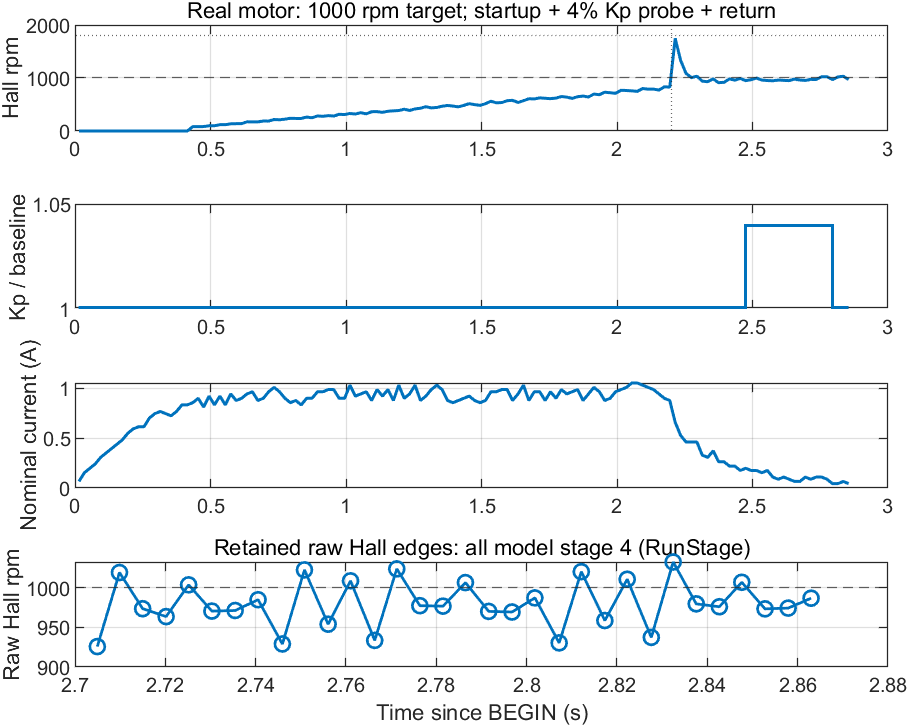
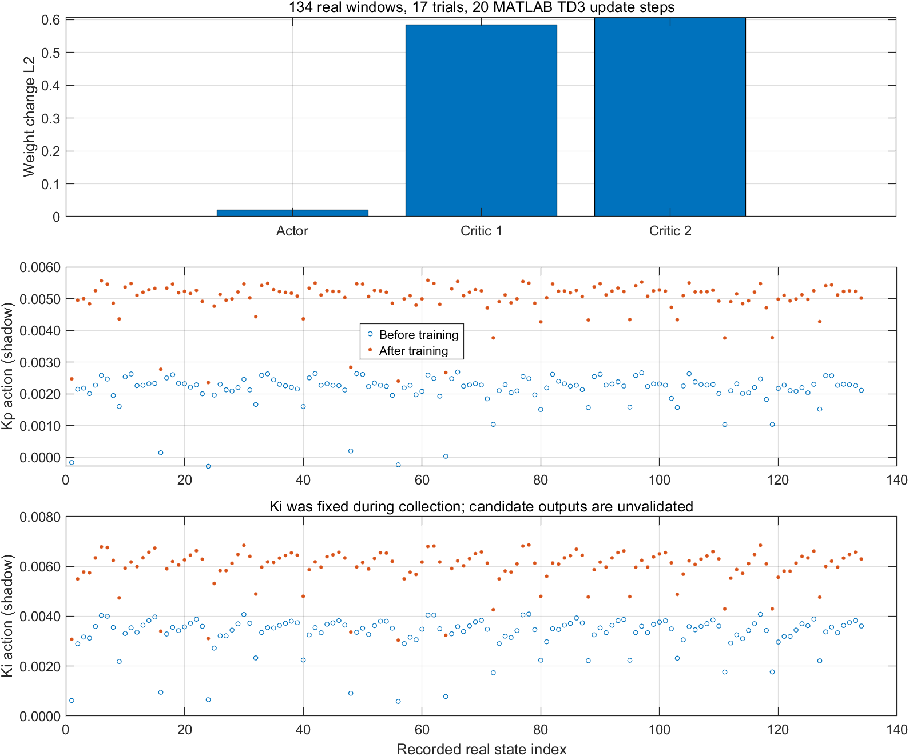

# 自动调整控制器超参数的方法框架：四种可移植方法对比与电机速度环示例

本仓库提供一个用于**自动调整控制器超参数**的方法框架，并比较四种可以移植到不同控制对象和板卡的方法。当前以电机速度环为例：在相同模型、相同给定和相同测试工况下，比较四种方法对跟踪误差、电流、过冲、饱和和故障的影响。相同流程也可用于位置环、姿态环、温度环、压力环、流量环以及其他需要自动调参的控制任务。

## 最新实机数据与训练状态（2026-10-12）

**最新进展：累计 47 次独立实机试验、428 个短窗口；严格响应窗口已达到 128 个训练样本、39 个会话隔离验证样本。**新增六轮基准 PI / Ki 探测全部故障为 0，STOP、六路关闭、核心暂停和 CAN 释放已确认。Codex 审计真实数据，调用 MATLAB 完成四组噪声 / 行为克隆对照及固定 400 步检查，共 15 个候选、2160 步实际更新。[严格训练与原因分析](docs/speedloop-v5-strict-followup-20261012.md)，[原始遥测、实际增益、网络权重和报告](examples/speedloop-v5-real-20261012/strict-followup-20261012)。

较小目标噪声使验证状态上双 Critic 的平均分歧降低约 61.5%，但四组的 Kp 建议方向仍随种子改变，不能据此声称电机误差改善。严格训练已经实际运行；新 Actor 尚无对应实机性能证据，**保持基准 PI，部署许可 false，温度门不变。**下列 41 次 / 35 次记录保留为此前阶段的历史结果。

**后续更新：已新增六轮实机采集，累计 41 次独立试验、369 个短窗口。**六轮故障均为 0，STOP、六路输出关闭、核心暂停和 CAN 释放均通过。Codex 修正了保活命令与实际增益变化的响应计时，完成新一轮 MATLAB TD3+BC 实验训练：3 个候选、240 步更新、540 条训练后回放建议。[本轮报告](docs/speedloop-v5-response-windows-20261012.md)，[原始数据、实际增益与候选](examples/speedloop-v5-real-20261012/response-window-20261012)。

严格窗口得到 106 个训练窗口，仍不足 128；独立的探索窗口实验使用 146 个训练窗口、47 个验证窗口。**探索训练不表示严格准入通过。新候选的 Kp 方向仍不一致，未应用到板子；保持基准 PI、Ki=0.00144，部署许可仍为 false。**本次建议为训练后离线回放，运动期间未使用新 Actor。

下面保留前一轮的窗口口径和训练对照：

Codex 已审计 **35 次电机实物试验、311 个有效动作窗口**，调用 MATLAB 对普通 TD3 和加入行为克隆的 TD3 做相同条件的四组对照：228 个训练窗口、83 个会话隔离验证窗口、12 个候选、960 步实际更新。Actor、双 Critic 权重与 Q 值诊断已公开。[问题分析与复现说明](docs/speedloop-v5-offline-diagnosis-20261012.md)，[数据和训练报告](examples/speedloop-v5-real-20261012/offline-study-20261012)。

Codex 发现并修正了基准标签、动作掩码和旧策略结果误用于新候选的准入问题。**当前候选均未通过筛选，保持基准 PI，Ki 为 0.00144；部署许可为 false。**温度门保持原样，未把 Q 值或日志重放当成新策略的实机性能。

| 环节 | 已完成的工作 | 当前结论 |
|---|---|---|
| MATLAB 训练更新 | 真实状态、实际增益、后续响应、奖励进入原生 TD3 回放池 | 权重实际更新；性能尚未证明 |
| 实时旁路预测 | Codex 管理 CAN 采集与 MATLAB TCP 服务，记录 45 ms 期限内建议 | 与实际参数回读分别保存 |
| 实机性能验证 | 初始 Actor 的三对 Kp A/B 试验 | 未稳定改善，保持基准 PI |
| MCU 部署 | Codex 可生成、编译、数值核对并管理板端接入；本次未生成最终 C 文件 | 实机、未训练工况和保护门通过后才能部署 |

本次参考：[TD3+BC 原论文](https://arxiv.org/abs/2106.06860)、[MathWorks 原生行为克隆选项](https://www.mathworks.com/help/reinforcement-learning/ref/rl.option.rlbehaviorcloningregularizeroptions.html)。算法依据与本项目实机性能证据分别记录。

## 核心是四种方法

**固定 PI 只作为基线。真正要比较的是下面四种方法，而且四种方法都面向使用者开放移植。** 使用者可以根据自己的控制对象、传感器、参数边界、通信接口、MCU、编译链和实时周期，移植其中任意一种或同时移植四种。

- **AI skill 有界搜索（AI skill bounded search）**
- **模糊 PID（fuzzy PID）**
- **神经网络 PID（neural-network PID）**
- **TD3 Actor**


上图是电机速度环示例的统一对比截图。最新论文改进后的代码结果见下表和[机器可读报告](examples/controller-comparison-20261011/comparison-report.json)。

| 方法 | 平均归一化 RMSE | 平均峰值电流 (A) | 平均过冲 (rpm) | 饱和占比 | 故障 |
|---|---:|---:|---:|---:|---:|
| 固定 PI 基线 | 0.174773 | 2.4717 | 0.000 | 0.0089 | 0 |
| AI skill 有界搜索 | 0.171898 | 2.3806 | 0.799 | 0.0072 | 0 |
| 模糊 PID | 0.165461 | 2.7177 | 0.000 | 0.0194 | 0 |
| 神经网络 PID | 0.164814 | 2.6925 | 0.000 | 0.0178 | 0 |
| TD3 Actor | 0.166923 | 2.5023 | 0.000 | 0.0100 | 0 |

这些数值是相同确定性 mock 工况下的仿真结果，用于比较方法。它们不代表任意电机、负载或板卡上的实机性能。

## 四种方法怎么工作

### 1. AI skill 有界搜索

这是一个“读取数据 → 分析波形 → 生成候选 → 串口下发 → 验证结果”的闭环调参器。Python 串口桥接器读取速度、给定值、电流、母线、故障、当前实际 Kp/Ki、序号和时间戳；高频原始帧保存在本地，再按窗口整理成稳态误差、RMSE、上升/稳定时间、过冲、峰值电流、饱和比例和故障摘要。

本项目使用 **GPT-6.1-sol** 分析结构化波形摘要和必要的数据窗口，提出 Kp、Ki 或其他控制器超参数的有界候选。主机侧安全门检查上下限、单步变化、动作租约、故障状态和停机条件，再通过串口发送带校验的原子参数命令。MCU 返回实际应用值、序号和时间；候选恶化或违反约束时回退到已验证参数。

GPT-6.1-sol 负责低频的波形理解和候选搜索，实时控制、参数限幅和独立保护仍由目标设备执行。迁移到其他控制器时，替换串口协议、观测字段、参数边界和目标函数即可。

### 2. 模糊 PID

误差 `e` 和误差变化率 `de` 先归一化并截断到 `[-1,1]`，再使用七个语言变量 `NB/NM/NS/ZO/PS/PM/PB`。内部语言变量使用重叠三角隶属函数，两端使用梯形隶属函数。两个输入形成 `7×7=49` 个规则组合；规则根据误差大小和变化趋势给出 `ΔKp`、`ΔKi`。

规则激活度采用乘积或最小值，输出采用离散重心/加权平均解模糊：

```text
ΔKp = Σ(activation[i,j] × ΔKp_rule[i,j]) / Σ activation[i,j]
ΔKi = Σ(activation[i,j] × ΔKi_rule[i,j]) / Σ activation[i,j]
Kp  = clip(Kp_base × (1 + ΔKp), Kp_min, Kp_max)
Ki  = clip(Ki_base × (1 + ΔKi), Ki_min, Ki_max)
```

代码使用 7×7 显式规则面、三角/梯形隶属函数和有界输出。论文改进路线是用多工况数据优化隶属函数断点和规则表，并比较 5×5、7×7 与稀疏规则在误差、过冲、计算周期和内存上的折中。规则表、隶属度计算和解模糊逻辑都可以移植为 MCU 查表或定点实现。

### 3. 神经网络 PID

本仓库把神经网络 PID 定义为一个可审计的监督学习调度器。网络输入是五个归一化特征：误差、误差变化量、积分状态、当前速度和目标速度；当前结构为 `5 → 16 → 16 → 2`，输出经过线性缩放得到有界 Kp、Ki。

网络在主机侧学习已检查过的模糊 PID 调度，并使用训练/验证划分；代码还对训练范围外的状态回退到模糊调度，避免直接外推。板端只运行固定权重的前向推理，不运行反向传播，也不直接输出 PWM。迁移时重新生成覆盖目标工况的数据，验证输入缩放、量化误差、执行时间、内存和异常回退即可。

### 4. TD3 Actor

TD3 在主机侧训练 Actor、双 Critic、经验回放和目标网络；部署到设备时只保留有界 Actor 推理。完整流程是：

```text
MCU：FOC + 速度 PI + 独立保护
           ⇅ 串口 CRC 帧、原子增益命令、实际应用反馈
Python：持续采集、安全监控、动作租约、单一端口所有者
           ⇅ 认证的本机 TCP
MATLAB：Actor 推理 → 有界试验 → 确认停机 → TD3 更新
           ↓
固定策略评估 → Actor JSON → C99 推理 → 目标工程接入/PIL

Codex：配置、启动、读取日志摘要、比较训练结果、管理部署。
```

四种方法的仿真比较入口要求 TD3 评估摘要标记为 simulation-only，并通过统一工况和安全指标检查。实机经验使用独立采集和审计入口，不混入该仿真表。论文改进路线是分阶段探索、加入稳定性拒绝条件、扩展未见负载/给定测试，并在 Actor 外增加动作边界、步长限制和安全监督器。

## 根据论文落实的代码改进

`scripts/controller_comparison.py` 已把论文建议落到四种方法：

| 方法 | 已落实的代码改进 |
|---|---|
| AI skill 有界搜索 | 粗到细的有界搜索、多目标评分、峰值电流/过冲/故障安全门、候选计数和回退条件。 |
| 模糊 PID | 7×7 三角/梯形隶属函数、显式规则面、加权重心解模糊、有界 Kp/Ki。 |
| 神经网络 PID | 监督拟合模糊调度、训练/验证划分、验证损失记录、训练范围外回退。 |
| TD3 Actor | simulation-only 输入门、外部 TD3 评估源、统一测试工况和安全指标审计。 |

论文提供设计方向，仓库代码提供可复现的仿真比较；两者都不能替代目标系统的参数辨识、实时预算和独立保护验证。

详细的论文与改进映射见 [skill 参考](skills/controller-hyperparameter-comparison/references/method-improvements.md)。

## 运行四种方法的统一比较

需要 Python 3.12 和 NumPy。`--td3-evaluation` 是 MATLAB 导出的 simulation-only 评估摘要；脚本不会打开串口、CAN 或 Flash。

```text
python -B scripts/controller_comparison.py --output OUTPUT \
  --td3-evaluation examples/mock-validation/evaluation-summary.json
```

输出文件：

- `comparison-report.json`：方法、工况、指标、改进配置和安全门结果。
- `comparison.csv`：可直接画图或做统计检验的数据。
- `comparison.md`：适合放进实验记录的表格和解释。

仓库已保存一份示例结果：[comparison-report.json](examples/controller-comparison-20261011/comparison-report.json)、[comparison.csv](examples/controller-comparison-20261011/comparison.csv)、[comparison.md](examples/controller-comparison-20261011/comparison.md)。

## 打包成 Codex skill

本仓库提供独立的 [controller-hyperparameter-comparison skill](skills/controller-hyperparameter-comparison/SKILL.md)。它不绑定某一块电机板，负责：

- 设计四种方法的统一对比实验；
- 把论文建议转成数据、规则、网络和安全门设计；
- 按目标控制器和 MCU 生成可移植的实现方案；
- 比较误差、电流、过冲、饱和、故障、执行时间和内存；
- 保留训练/搜索证据和目标设备接口契约。

在 Codex 中安装 `skills/controller-hyperparameter-comparison` 后，可以这样调用：

```text
使用 $controller-hyperparameter-comparison，比较这四种控制器超参数调优方法，
然后按照我的控制对象和 MCU 接口给出可移植实现。
```

## 论文参考

- [Physics-Informed Framework for PID Tuning with Large Language Model Agents](https://arxiv.org/abs/2607.26594)：结构化响应特征、控制工程诊断、物理先验和验收标准。
- [Fuzzy Logic Driven Self-Tuned PI Controller for Enhanced Speed Regulation of PMSM Drives](https://doi.org/10.1155/jece/7690514)：7×7 规则、隶属函数和重心解模糊。
- [A New Method for the Speed Control of a Brushless DC Motor Based on Optimized Fuzzy Control](https://doi.org/10.5152/electrica.2026.25063)：离线优化模糊规则和隶属函数。
- [Design of Fuzzy PID Controller Based on Sparse Fuzzy Rule Base](https://doi.org/10.3390/machines11010081)：稀疏规则与计算量折中。
- [A New On-Line PID Tuning Method Using Neural Networks](https://doi.org/10.1016/S1474-6670(17)38283-6)：神经网络估计过程特性并更新 PID。
- [ANN Based Self-Tuned PID-Like Adaptive Controller](https://doi.org/10.1016/j.eswa.2014.06.040)：小型网络、递推适应与参数变化鲁棒性。
- [Addressing Function Approximation Error in Actor-Critic Methods](https://arxiv.org/abs/1802.09477)：TD3 双 Critic、延迟更新和目标策略平滑。
- [A Novel Entropy-Maximizing TD3-based Reinforcement Learning for Automatic PID Tuning](https://arxiv.org/abs/2210.02381)：分阶段探索和 PID 调参。
- [Stability-Preserving Automatic Tuning of PID Control with Reinforcement Learning](https://arxiv.org/abs/2112.15187)：将稳定性纳入 RL 调参过程。
- [Safe Reinforcement Learning Using Robust Action Governor](https://arxiv.org/abs/2102.10643)：在策略外增加安全监督器。

论文中的模型、规则范围、随机探索和奖励权重不能直接当作某块板子的安全参数。移植到目标设备后，需要重新验证输入尺度、参数边界、实时周期、内存、通信和独立保护。

## STM32G431 实机接入进度

以用户已正常运行的 `17.SpeedLoop` 为控制基线，Codex 已把 CAN 的 BEGIN/GAINS 动作接到生成的 1 ms 速度 PI 边界。**板上版本为 g431-speedloop-pi-motion-v5。首次训练使用 17 次真实试验、134 个闭环经验；之后已完成初始 Actor 的 Kp 实机 A/B，但未通过性能门。最新状态见上文。**下面保留接入过程和各版实测。

- 49 个翻译单元编译通过；20 项 PI 核心检查和 10 项实际生成模型检查通过。
- 已在 **24 V 功率电源物理断开**时烧录到 STM32G431，并按完整应用镜像回读；构建与回读 SHA-256 一致。
- 修复 v1 初始化失败：原转速计划含 1800/2000 rpm，违反 1800 rpm 的严格上限；首轮计划收窄为已观察过的 1000 rpm，没有提高保护上限。
- 修复 v1 采样中断：本例程的 CH4 触发依赖 MOE。等待启动时保留 CH4/MOE，但关闭三相通道，并将 PA8/9/10、PB13/14/15 六路功率引脚切为 GPIO 低电平；STOP 同时关闭 MOE 和三相通道。
- 板上断电运行约 0.5 秒，ADC 采样计数达到 **4970**，零点采样完成，端点就绪且故障为 0；三相输出没有自行开启。
- CAN 初始化在 ADC/model 中断之前完成；三相启动改为一次 CCER 使能，取消逐路 HAL Start。母线转换成功才刷新测量时间，启动与运动中拒绝过期采样。
- USER3 在本版只触发停机。启动使用每次复位后独立、一次性消费的会话标识，普通复位不能沿用旧会话。试验最长 3 秒。
- 本次按用户要求没有启用温度门；板上没有可用温度传感器。软件电流边界使用 2 A 名义值，硬件比较器仍保留，但其实际跳闸电流尚未用受控电流源标定。

缺失温度在专用试验遥测中保留为 `null`；普通训练入口仍拒绝缺失测温门，本次例外不修改 `SKILL.md`。新增 8 项实际运动适配器启动检查、3 项缺失温度编解码检查和 19 项标准 CAN 回归均通过，这些是主机软件检查。

此前的静态记录证明编译、烧录、完整回读和板上禁止运动采样，不能作为 TD3 经验。随后已经执行第一次真实 BEGIN/GAINS 试验，结果见下文。

v2 随后的真实 HELLO 已回包，但完整状态检查发现时间故障 9，STOP 后已确认 MOE 和三相输出关闭。原因是 ADC 抢占 SysTick 导致保护时间倒退。修正版 `g431-speedloop-pi-motion-v3` 在相同抢占检查下通过，还将完整遥测周期缩短为 20 ms，并修复主循环失联时必须直接关闭输出的问题；10 项运动适配器检查、3 项专用编解码检查和 26 项禁止运动适配器回归通过。

**v3 已烧录并通过真实 CAN 完整状态采集：116 组状态帧，序号与时间连续，故障均为 0。**名义母线电压 24.215～24.550 V，名义峰值相电流 0～0.04395 A；缺失温度均为 `null`。STOP 后 MOE 和三相通道关闭、核心暂停，之后才释放 CAN。采集没有发送 BEGIN/GAINS，实际应用序号均为 0；它证明实时观测和收尾链路已工作，**不代表已取得 TD3 动作经验或训练结果**。

本次接通 24V 后观察到 MCU 复位并清除准备标识。按用户已授权保留 24V 的要求，重新准备限定于完整哈希一致的这份 v3 镜像：先确认 MOE 关闭、六路功率引脚 GPIO 低电平，再复位并创建独立会话；没有擦写 Flash 或启动电机。这项专用例外不能用于任意固件。

Codex 的工作包括分析真实遥测与训练结果、检查实际应用参数和停止状态、按独立工况判断候选是否改善，以及生成、验证和烧录部署文件。MATLAB 负责 TD3 梯度训练，MCU 执行实时 FOC 和保护；**当前进度不代表 Actor 已部署或四种方法均已实机比较**。

### 2026-10-11：v3 参数应用与启动保护记录

Codex 管理的主机程序已在这块板子上发送 BEGIN 和 GAINS，MATLAB 审计确认 **12 次成对 Kp、Ki 实际应用**，应用延迟为 29.997～48.999 ms；取得 40 组完整状态，板端采样间隔约 20 ms。
初始增益为原例程的 Kp=0.003389、Ki=0.00144，目标 1000 rpm。试验仍在开环启动时，Hall 转速瞬间报告 5972 rpm，触发原有 1800 rpm 超速保护并停止；没有提高保护上限。最终六路功率输出关闭、核心暂停、CAN 释放。

这次已验证真实的“下发 → MCU 实际应用 → 反馈 → MATLAB 分析”链路。**没有进入速度闭环，没有执行计划中的 4% Kp 探测，也没有训练或部署 TD3。** Codex 将这段启动/保护数据排除出训练经验；后续先核对 Hall 边沿和启动阶段，再采集闭环参数响应。[完整实测记录与原因分析](docs/speedloop-real-gain-trial-20261011.md)、[MATLAB 分析](examples/controller-comparison-20261011/speedloop-real-gain-analysis.json)。

针对例程直接使用 16 位 Hall 周期的问题，Codex 已实现 v4：完整微秒周期、扇区方向检查及原始边沿记录；50 个翻译单元、10 项 Hall 专项和运动适配器检查通过，1800 rpm 上限保持不变。2026-10-11 因 STLink 未连接没有擦写；2026-10-12 恢复连接后已烧录并完成以下实测。

### v4 实机结果：闭环、4% Kp 探测与恢复

**这次是真实 STM32G431 与真实电机数据，没有使用 mock 数据替代。** Codex 完成 v4 烧录、完整镜像回读、禁止运动启动检查，随后管理一次最长 3 秒、目标 1000 rpm 的试验。参数从 Kp=0.003389、Ki=0.00144，小幅探测到 Kp=0.00352456，然后恢复；Ki 没有变化。

| 实测项目 | 结果 |
|---|---:|
| 完整状态 / 输出使能状态 | 151 / 143 组 |
| 确认实际生效的 Kp/Ki 成对命令 | 46 次；两组不同参数 |
| 源状态到参数实际应用的延迟 | 28.996～49.993 ms |
| 板端遥测采样间隔 | 19.994～20.808 ms |
| 全程采样最高 Hall 转速 | 1748.252 rpm；原 1800 rpm 保护未提高 |
| 名义峰值相电流 | 1.054688 A；转换尚未独立标定 |
| 保留下来的原始 Hall 边沿 | 32 条，均为 RunStage（阶段 4） |
| 这段原始 Hall 转速范围 | 925.755～1032.418 rpm |
| 同期 8 个遥测点的 RMSE | 26.601 rpm；仅约 0.14 秒窗口 |
| 故障、STOP、输出关闭 | 状态故障为 0；STOP 确认，六路输出关闭后暂停核心 |



**Codex 在这次实测中的作用：**管理编译和烧录，持续接收真实遥测，下发有界参数并核对 MCU 实际应用值、序号和时间；调用 MATLAB 分析原始响应，判断哪些窗口有动作与闭环证据，记录停止状态并发布可复核的数据。MATLAB 负责 TD3 梯度训练，MCU 负责实时 FOC。后续 Codex 可以分析训练结果、组织独立评估，生成并验证 Actor 的 C 推理文件、管理烧录部署；**本次烧录的是 PI 采集固件，尚未训练或部署 Actor。**

MATLAB 已提取 **10 个因果完整的动作窗口候选**，其中 **2 个有保留的原始 RunStage 边沿直接佐证**。它们目前是待审计候选，未加入普通 TD3 经验池。现有训练代码要求 128 个合格经验窗口才开始更新；151 个遥测点、46 次增益刷新不能冒充 151 或 46 个闭环训练经验。缺失温度仍为 `null`，专用短试验例外没有修改 `SKILL.md` 或普通训练门。

这一次“启动 → 探测 → 恢复”的顺序还混有闭环切换瞬态，不能证明 4% 增益更优，不能与不同窗口的旧基线或四种方法仿真表直接比较。下一阶段是补充闭环阶段与动作覆盖，再由 MATLAB 训练、Codex 审查固定策略结果；不能直接部署初始化 Actor。[完整实测说明](docs/speedloop-v4-closed-loop-trial-20261012.md)、[MATLAB 分析](examples/speedloop-v4-real-20261012/analysis.json)、[原始数据与文件校验](examples/speedloop-v4-real-20261012/evidence-manifest.json)。

### 最新：134 个真实闭环经验，MATLAB TD3 已实际更新

Codex 将 Hall 环形记录从 32 条扩到 512 条，保留整次短试验的原始阶段证据；固件已完整回读一致。随后修正了“最后动作尚未取得运动回读”和“过早停止刷新导致 100 ms 失联超时”两个主机收尾问题，失败记录也保留。最新复测在 2.80 秒主动 STOP，故障为 0，六路输出关闭后暂停核心。

| v5 最新实测 | 结果 |
|---|---:|
| 完整状态 / 输出使能状态 | 148 / 141 组 |
| 实际增益应用确认 | 44 次 |
| 原始 Hall 边沿 | 287 条全部保留，含对齐、开环和闭环阶段 |
| 原始 RunStage 边沿 | 125 条 |
| 有完整时序和原始闭环证据的动作窗口 | 8 个 |
| 初批 MATLAB TD3 实验经验池 | 8 个真实窗口；不是遥测点数 |
| 后续实机采集 | 另行授权的 16 轮，每轮至多 3 秒、间隔至少 30 秒，全部完成并正常停机 |
| 最终 TD3 经验池 | 17 次不同会话、134 个真实闭环窗口 |
| MATLAB TD3 更新 | 1 epoch、实际 20 steps |
| Actor / 两个 Critic 权重变化 L2 | 0.020293 / 0.584027、0.607209 |
| Actor C 数值验证 | 40 个合成计算向量通过；最大动作误差约 1.9×10⁻⁹ |
| Actor 上板 / 四种方法实机排名 | 尚未执行 / 尚未完成 |

MATLAB 使用真实 `rlTD3Agent.ExperienceBuffer`，检查重复试验、实际动作、状态串接与时间，按正常 STOP 的时间截断保留 bootstrap。初批仅 8 个窗口，保存 `replay-pending.mat`；补充采集后得到 134 个真实窗口，调用 `trainFromData`，保存 `experimental-candidate.mat`，Actor 和两个 Critic 均实际更新。这一入口是**实验旁路分析**，不开放新策略下发，不改普通训练门或 `SKILL.md`。



**Codex 已实际完成训练结果分析与部署文件准备：**核对数据来源和哈希，调用 MATLAB 训练，检查经验池及 Actor/Critic 权重变化，分析候选的旁路输出，导出 482 参数的 Actor JSON/C99 文件并完成主机 C 与 MATLAB 数值一致性检查。C 文件尚未烧录或在 MCU 上验证。当前采集只覆盖 Kp 探测、Ki 固定；候选却给出非零 Ki 动作，因此本版不能宣称 Ki 调度可靠或性能优于原 PI。下一步须单独验证动作覆盖和固定策略响应，才可评估板端部署。

初次 v5 完整闭环窗口包含切换瞬态，31 个点的 RMSE 为 145.682 rpm。它比 v4 图中只取末段约 0.14 秒的 26.601 rpm 窗口更长，不能将二者直接排序。这些是采集行为的响应，不是新 Actor 的实机成绩。[v5 实测与训练说明](docs/speedloop-v5-experimental-replay-20261012.md)、[MATLAB 训练摘要](examples/speedloop-v5-real-20261012/training-summary.json)、[Actor C 计算文件](examples/speedloop-v5-real-20261012/actor-calculation-only/motor_actor.c)、[数据清单](examples/speedloop-v5-real-20261012/evidence-manifest.json)。

### 2026-10-12：MATLAB 实时旁路已在真实电机上跑通

这一步把 MATLAB 固定 Actor 接到真实板端遥测的旁路通道。桥接线程接收 STM32G431 的完整状态，MATLAB 返回版本化、限幅后的 Kp 建议；建议绑定到原始 `boot_id/seq/t_us`，超时、重复帧、跨会话帧和错误令牌都会被拒绝。桥接线程与采样、停机线程分离，MATLAB 卡顿不会阻塞停机。

实机验证只让原有基准 PI 控制电机，**没有把 Actor 建议写回 MCU，也没有在线训练或改变 `SKILL.md` 的普通门槛**。由于真实数据没有 Ki 探测，实时旁路固定 Ki=0.00144，并明确标记为受限的 Kp-only 建议。

| 实时旁路实测 | 结果 |
|---|---:|
| 完整板端遥测 / MATLAB 返回 | 148 / 148 |
| 45 ms 决策期限内接受 | 148 |
| MATLAB 往返延迟 p50 / p95 / 最大 | 6.17 / 7.83 / 13.68 ms |
| 实际下发 Actor 增益 | 0 次（基准 PI 保持） |
| 基准 PI 的名义峰值电流 | 1.032715 A |
| 峰值 Hall 转速 | 1782.531 rpm（1800 rpm 保护上限未提高） |
| 故障 / STOP / 六路输出 | 0 / 已确认 / 已关闭 |

这次 3 秒试验的原始遥测、MATLAB 建议、命令、Hall 边沿和哈希清单见 [`realtime-shadow-20261012`](examples/speedloop-v5-real-20261012/realtime-shadow-20261012/)，说明见[实时旁路记录](docs/speedloop-v5-realtime-shadow-20261012.md)。这是链路和实时预算验证，不是 Actor 性能优于 PI 的结论；下一步若要比较固定 Actor，必须另行授权并使用未参与训练的工况。

对这 148 条实时建议又做了独立的动作审计：148 条全部与原始 `boot_id/seq/t_us` 对齐，全部在增益范围和单步范围内，Ki 掩码保持基线值。这个审计没有把建议写回电机，因此没有生成 Actor 的反事实性能分数；报告见 [`actor-shadow-audit.json`](examples/speedloop-v5-real-20261012/realtime-shadow-20261012/actor-shadow-audit.json)。

### 2026-10-12：固定 Actor Kp 单次实机试验

在旁路链路通过后，用户授权一次最多 3 秒的固定 Actor 试验。Codex 将 MATLAB 返回的 Kp 建议按原有范围、单步限制和实际应用回读写入板端；Ki 仍固定为 0.00144，FOC、失联停机和硬件比较器保持不变。

| 同预算单次试验 | 基准 PI | Actor Kp |
|---|---:|---:|
| 参与闭环快照 | 140 | 140 |
| 末段窗口 RMSE（含切换过程） | 160.788 rpm | 136.624 rpm |
| 峰值名义电流 | 1.032715 A | 1.076660 A |
| 峰值 Hall 转速 | 1782.531 rpm | 1630.789 rpm |
| 故障 / STOP / 输出关闭 | 0 / 通过 / 通过 | 0 / 通过 / 通过 |

这两组各只有一次试验，窗口仍包含启动和切换过程，电流也没有独立标定。因此这些是观察到的单次结果，不能作为 TD3 已优于 PI 的结论；完整对比报告见 comparison.json，原始文件见 realtime-actor-kp-20261012 目录。

随后完成了 3 组基准 PI 与 3 组 Actor Kp 交替重复试验，总运动预算 18 秒、每轮间隔 30 秒，全部正常停机：

| 三组配对均值 | 基准 PI | Actor Kp | Actor−基准 |
|---|---:|---:|---:|
| 末段窗口 RMSE | 144.734 rpm | 149.636 rpm | +4.902 rpm |
| 峰值名义电流 | 1.040 A | 1.055 A | +0.0146 A |
| 峰值 Hall 转速 | 1670.556 rpm | 1726.111 rpm | +55.555 rpm |

重复结果没有显示 Actor Kp 的稳定改善，当前部署建议保持基准 PI。详细统计和每轮原始数据见 repeated-ab-20261012 目录；该报告仍将 performance_claim_allowed 设为 false。

### 2026-10-12：增强惩罚 TD3 离线重训与准入结果

6 轮 A/B 数据与原有 17 次真实试验合并后，审计得到 194 个真实动作窗口，其中 150 个用于训练、44 个作为固定验证集。新训练同时保留旧奖励，新增电流、接近速度保护上限和饱和惩罚；Ki 动作掩码为 0，Ki 固定 0.00144。MATLAB R2024b 使用随机种子 7、17、27 分别训练 80 个 step，三组都通过动作和增益范围检查。

三个种子的 Kp 动作方向不一致，且没有任何离线方法能证明 Actor 的真实闭环性能。结合重复实机结果，候选准入报告将当前候选拒绝，保持基准 PI；没有生成部署许可，也没有烧录 Actor。完整报告见 reweighted-td3-20261012 目录。

### 2026-10-12：Ki 局部覆盖数据已采集

为避免把未探索的 Ki 输出交给 Actor，新增 6 轮固定 PI 数据采集：Kp 保持基准值，Ki 在局部步长的 ±25% 范围内做小幅探测。6 轮均正常停机、故障为 0，正负 Ki 实际应用值均有回读。

加入这批数据后，经验池为 253 个窗口，训练 / 验证划分为 199 / 54，TD3 训练启用双输出动作掩码 [1,1]。Ki 已有真实覆盖，但三个随机种子的 Kp 方向仍不一致，候选准入仍被拒绝；因此没有应用 Actor，也没有烧录。

Ki 原始数据见 ki-coverage-20261012，双输出重训和准入结果见 reweighted-td3-ki-20261012。

- [运动版构建和烧录回读记录](examples/controller-comparison-20261011/speedloop-pi-motion-flash.json)
- [v2 修正与板上启动采样记录](examples/controller-comparison-20261011/speedloop-pi-motion-v2-startup.json)
- [v2 HELLO 与时间故障实测记录](examples/controller-comparison-20261011/speedloop-pi-motion-v2-handshake.json)
- [v3 完整状态采集与 STOP 实测](examples/controller-comparison-20261011/speedloop-pi-motion-v3-handshake.json)
- [v3 实际采集的 116 组静态状态](examples/controller-comparison-20261011/speedloop-pi-motion-v3-disabled-telemetry.jsonl)
- [v2 启动问题与修复说明](docs/speedloop-motion-v2-startup-20261011.md)
- [原始 SpeedLoop 实机基线](examples/controller-comparison-20261011/real-speedloop-baseline-user3.json)
