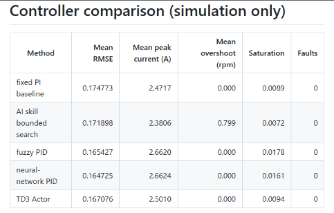
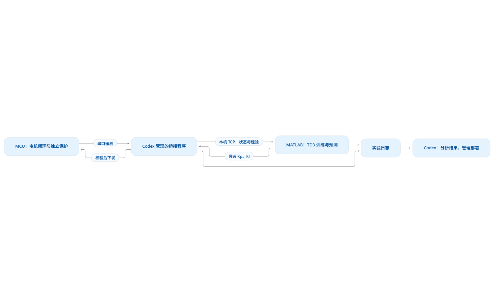

# 电机速度环四种方法对比：控制系统超参数调优的通用示例

本仓库的核心是比较四种用于**控制系统超参数调优**的方法，而不是只服务于电机。电机速度环只是当前的示例场景：在相同模型、相同给定和相同测试工况下，比较四种方法对跟踪误差、电流、过冲、饱和和故障的影响。相同的实验框架也可以用于位置环、姿态环、温度环、压力环、流量环以及其他需要自动调整控制器超参数的任务。

重要的是下面四种方法：

- **AI skill 有界搜索（AI skill bounded search）**
- **模糊 PID（fuzzy PID）**
- **神经网络 PID（neural-network PID）**
- **TD3 Actor**

固定 PI 只作为比较基线，不是四种方法之一。四种方法都可以直接用 AI 按目标板卡的接口、算力、编译链和实时约束生成或移植为 MCU 可运行的 C/C++ 实现；训练、搜索和模型分析留在主机侧，板端只保留所需的控制或推理部分。

下面的图片展示了以电机速度环为例的四种方法对比结果：



把电机串口数据送进 MATLAB 训练 TD3，输出有界的速度环 Kp、Ki，经串口应用确认后形成学习经验；Codex 管理实验和分析结果，最终导出仅用于推理的 Actor C 代码。

现已增加经典 CAN 的应用层与 `--transport can` 入口：沿用 MATLAB 的状态/动作接口，加入会话、时效、分帧校验和实际参数回读。**CAN 物理链路已实测；用户 SpeedLoop 的禁止运动诊断固件已烧录，真实握手与 3 秒连续遥测通过。早期 PID/NNSMC 接入版完成编译和 RAM 检查，尚未完整上板运行；实机训练保护仍待验证。**

**Codex 可以管理 TD3 训练、分析训练结果，并将经过数据门槛和独立评估的 Actor 部署到单片机执行。** 本项目已跑通 mock MATLAB TD3、独立评估和 STM32G431 RAM 推理验证；这不等于已经用用户电机数据训练。当前 `17.SpeedLoop` 的真实试转仍是基线遥测，未应用 TD3 增益。真实 Actor 必须先通过 [真实数据门槛](docs/td3-actor-real-data-gate.md)，再接入 SpeedLoop。

**最新工程进展：现有 CAN 协议已接入用户 `17.SpeedLoop` 的真实速度 PI。** Codex 解决模糊增益覆盖问题，把参数提交放到原生成模型的 1ms 边界，保持积分输出连续，并连接实际生效序号/时间的反馈。主机上的 10 项 CAN→真实模型检查、19 项 CAN 运行器回归通过，49 单元 Cortex-M4 工程编译成功；此前 30 项 PI 检查和 2000 步基准对照保持通过。**既有物理 CAN 验证直接复用，本阶段没有重测连线或操作板子。** 新复核镜像仍禁止运动，运行固件保护/启动接入与 Actor 尚待完成。[CAN→PI 实现与验证](docs/speedloop-can-pi-integration.md) · [此前 PI 接入](docs/speedloop-pi-integration-validation.md)

## Codex 在这里做什么

| 工作 | Codex 的具体作用 | 本项目证据 |
|---|---|---|
| 管理训练 | 检查接口、配置实验、启动桥接与 MATLAB；MATLAB 执行 TD3 梯度更新 | [20 轮 mock TD3 更新](examples/mock-validation/training-summary.json) |
| 审计训练数据 | 检查实际生效的参数、动作序号、时间和下一状态能否对应 | [780 条经验审计](examples/mock-validation/experience-audit.json) |
| **分析训练好坏** | 比较固定 PI 与固定 TD3 的误差、超调、电流、饱和和故障；解释候选是否值得使用 | [独立评估](examples/mock-validation/evaluation-summary.json)：改进 TD3 在 mock 工况优于 PI，但仍未批准电机闭环部署 |
| **部署到单片机** | 导出 Actor C、目标编译、核对芯片、加载到 MCU RAM、读取并分析推理结果 | [G431 板上验证](docs/stm32g431-validation.md)：40 组通过，Kp/Ki 与 MATLAB 一致 |
| 诊断实际通信 | 对照示例与原理图，构建 CAN 专用 RAM 程序，分析控制器状态、回包与 PWM 禁能状态 | [CAN 板上验证](docs/stm32g431-can-diagnostics.md)：64 组内部回环、16 组电脑与板端双向收发通过 |
| 验证失联与独立复位 | 集成前台/ADC/心跳监督，分析故障与复位原因，核验复位后禁止启动 | [SpeedLoop 集成实测](docs/speedloop-watchdog-integration-validation.md)：三种断电故障及真实 CAN 停止心跳复位通过；运动停机时限仍待验证 |
| 设计无传感器热保护 | 核查电流单位和资料来源，实现 MCU 三相热预算，分析异常采样、过载和未知热状态重启的故障结果 | [热预算软件验证](docs/sensorless-thermal-validation.md)与[后续板上诊断](docs/thermal-board-validation.md)：禁止运动副本已烧录；实机热阈值尚未验证 |
| 接入 ADC 与热预算 | 编写校准范围、采样时刻和故障禁能检查，构建禁止运动的 SpeedLoop 副本并分析链接结果 | [接入离线验证](docs/thermal-feed-integration-validation.md)与[后续板上诊断](docs/thermal-board-validation.md)：真实采样通过，缺少电流标定时保持拒绝 |
| 分析热保护拒绝原因 | 编写 CAN 热状态回传与日志解析，检查三相累计预算、采样时效和故障，解释为何不能启动 | [板上热诊断](docs/thermal-board-validation.md)：29 组真实 CAN 快照审计通过，热限值与初始状态未知 |
| 接入实际速度 PI 与 CAN 参数 | 定位增益写入者和积分实现，把现有 CAN 端点接到真实 PI 边界，核对实际参数/序号/时间 | [CAN→SpeedLoop PI 验证](docs/speedloop-can-pi-integration.md)：10 项真实模型接入检查、19 项 CAN 回归、49 单元编译通过；运行固件保护与 Actor 待接入 |
| 接入真实工程 | 核对 PI/NNSMC 与刹车配置，编写锁定板级适配层，完整编译工程副本，在 MCU 验证共享禁能逻辑 | [FOC / CAN 接入](docs/stm32g431-foc-can-integration.md)：45 单元链接成功，16 项软件测试、11 项板上 RAM 测试通过 |
| 管理正式上线 | 接入真实观测与保护，构建/烧录目标固件，检查输入尺度、性能和实时预算 | 提供接入流程；本次尚未完成电机闭环与永久 Flash 部署 |

例如，Codex 的本次分析结论是：**原始训练的误差没有改善，原因是探索没有覆盖高增益区域；加入有界方向性覆盖、增加训练更新并把峰值电流/过冲/饱和写入奖励后，mock 三个工况的平均误差下降约 2.78%。网络可以上板计算，是否适合接管真实电机仍需单独验证。**

## 工作链路



<details>
<summary>查看文字版流程</summary>

```text
MCU：FOC + 速度 PI + 独立保护
           ⇅ 串口 CRC 帧、原子增益命令、实际应用反馈
Python：持续采集、安全监控、动作租约、单一端口所有者
           ⇅ 认证的本机 TCP
MATLAB：Actor 推理 → 有界试验 → 确认停机 → TD3 更新
           ↓
固定策略评估 → Actor JSON → C99 推理 → 目标工程接入/PIL

Codex：配置、启动、读取日志摘要、比较训练结果、管理部署。
```

</details>

实时闭环由板端和本地桥接器承担，不由聊天响应承担：MCU 在自己的 1 ms 速度环边界运行，桥接器持续读取串口/CAN；MATLAB 每个响应窗口从桥接器取得真实状态并给出下一步动作，Codex 先做范围、租约、序号、故障和实际增益回读检查，再把动作转发给板端。一个响应窗口结束后才生成一条可审计经验，训练梯度更新在该轮确认停机后进行，因此不会阻塞板端控制周期。桥接器会为 `transitions.jsonl` 生成 SHA-256，并把实时闭环标记和数据身份写入训练摘要；新训练的实机候选不会自动接管电机。

## 使用声明

> [!IMPORTANT]
> 本项目用于电机控制研究、仿真和经过验证的受限实验。公开结果包含模拟训练、主机测试，以及断开功率电源后的 STM32G431 RAM 推理验证。尚未完成真实电机闭环训练和正式固件部署验收，不构成实机安全、闭环稳定性或调参性能保证。

- **示例仅供演示：**模拟配置、PI 参数和示例网络不能直接用于真实电机；改进 TD3 的优势只在 mock 工况得到验证。
- **实机使用须先验证：**针对目标电机、驱动器和负载确认基准、参数边界、变化步长及电流/转速/电压/温度/持续时间限制，并验证原子参数更新、实际应用回读、独立过流、急停、失联保护和动作租约。
- **实验须明确授权并限制范围：**实机试验在已授权的工况、时间和动作预算内进行；发生故障先执行经验证的停机路径，禁止自动清故障或重启。
- **实时保护由 MCU 执行：**Codex 管理本地桥接和训练程序，不能代替 MCU 的实时闭环、独立保护或现场急停。
- **部署以独立验证为依据：**候选网络须与已验证控制器进行独立比较，并完成目标编译、内存/执行时间检查及 SIL/PIL；本次 RAM PIL 仅验证计算，不批准模拟网络控制真实电机。

## 一条命令复现

需要 Python 3.12、MATLAB Reinforcement Learning/Deep Learning Toolbox 和 GCC；本机链路已在 MATLAB R2024b 验证，使用 Instrument Control Toolbox 的 TCP 接口。串口模式另需 pyserial。Mock 不需要电机、串口或 Python 深度学习库。

从仓库根目录运行，`OUTPUT` 替换为项目规定的独立临时目录：

```text
python -B skills/motor-td3-serial-tuning/scripts/run_mock.py --output OUTPUT --rounds 6
```

MATLAB/GCC 不在 PATH 时增加 `--matlab MATLAB_EXECUTABLE --compiler GCC_EXECUTABLE`。使用新的空输出目录。

入口会启动模拟桥接器，调用真正的 MATLAB TD3，保存检查点，执行无探索的固定 PI/TD3 对比，导出 Actor C 文件并编译对齐 MATLAB 参考值。查看 `OUTPUT/run-summary.json`。

## 验证结果

仓库保存了 [模拟验证摘要与模型](examples/mock-validation)。它们可用于复现与检查代码，禁止直接上实机。

| 检查 | 结果 |
|---|---|
| MATLAB TD3 训练（原始设置） | 6 轮，180 条经确认经验，Actor 权重变化 L2 ≈ 0.0882；候选没有超过固定 PI |
| MATLAB TD3 训练（方向覆盖 + 安全代价） | 20 轮，600 条经确认经验，Actor 权重变化 L2 ≈ 2.7335；候选超过固定 PI |
| 训练和评估经验审计 | 780 条，时序/参数/回合链审计通过 |
| Python 桥接测试 | 17 项故障/通信测试通过，含实时回路元数据、停机后数据哈希和活动窗口拒绝 |
| MCU C 主机测试 | 19 项协议/保护检查通过 |
| MATLAB/C 推理对齐 | 40 组输入通过，NaN 被拒绝 |
| 独立工况平均归一化 RMSE | 固定 PI 0.171695；代价感知 TD3 0.166923 |

原始设置的问题是：局部增益动作每步只改变 `8e-5`，却使用独立零均值噪声；30 步回合的增益轨迹大多停留在基准附近，几乎没有覆盖高增益区域。网格检查发现 mock 对象的较优区域在 `Kp≈0.0043、Ki≈0.0022`，靠近边界。每轮只有 20 个训练步，也不足以让双 Critic 学会这个局部动作映射。

已改进模拟训练：仅在模拟对象中加入有界的方向性覆盖（四个角方向循环）和随机噪声，并在 128 条经验后使用 3 个 epoch、每 epoch 100 个训练步；奖励同时记录跟踪误差、电流均方值、峰值电流、过冲和饱和持续时间；真实串口仍保持小幅零均值噪声和更保守的训练计划。新的 20 轮结果：固定 PI 平均归一化 RMSE `0.171695`，TD3 `0.166923`，下降约 `2.78%`；三个工况分别从 `0.103565/0.169576/0.241945` 降至 `0.100370/0.164339/0.236059`。候选峰值电流为 `1.732/2.775/3.000 A`，基准为 `1.698/2.717/3.000 A`，最重工况饱和占比为 `3.00%` 对 `2.67%`；误差下降没有带来电流风险指标的同步下降。这是 mock 结果，不能直接推断真实电机效果。

改进解决的是数据覆盖和训练预算问题，不是把网络自动批准为电机控制器。新 Actor 仍需独立评估、RAM/SIL/PIL、保护验证和真实基准对比。

### 论文启发与当前取舍

- [EMTD3 自动 PID 调参](https://arxiv.org/abs/2210.02381)提出先用熵最大化的随机 Actor 探索，再切换确定性 Actor。我们在这个局部 Kp/Ki mock 上试过全随机暖启动，四角覆盖反而变差，因此当前实现保留可复现的方向覆盖；这不是把 EMTD3 论文直接宣称为已实现。
- [DC 电机 TD3-PI 研究](https://www.sciencedirect.com/science/article/pii/S0957417422022102)强调参考值滤波和随机负载扰动。当前 mock 已有种子化的惯量/负载变化；加入额外负载脉冲的实验没有改善这三个名义工况，下一步应在包含真实负载观测的模型上单独评估，不能用未观测扰动硬塞进实机训练。
- [Robust Action Governor](https://arxiv.org/abs/2102.10643)把安全监督器放在策略外层。仓库的增益边界、步长、应用回读、动作租约、停机确认和 MCU 独立保护就是这个原则的工程实现；奖励里的安全代价只是学习信号，不能替代保护。

这轮改进先选择了可验证的安全代价奖励。Codex 会同时分析 RMSE、峰值电流、饱和、过冲和故障，而不是只看一个训练分数；候选在任一项恶化时仍保持“待验证”状态。

## 参考论文

| 论文 | 对本项目的参考价值 |
|---|---|
| Fujimoto、van Hoof、Meger，*Addressing Function Approximation Error in Actor-Critic Methods*，[TD3 原论文](https://arxiv.org/abs/1802.09477) | 双 Critic、延迟 Actor 更新和目标策略平滑的算法基础。 |
| Chowdhury、Lu，*A Novel Entropy-Maximizing TD3-based Reinforcement Learning for Automatic PID Tuning*，[论文](https://arxiv.org/abs/2210.02381) | 提出随机 Actor 暖启动再切换确定性 Actor，用于改善 PID 调参的探索效率。本项目实测后保留方向覆盖，因为全随机暖启动在当前局部 Kp/Ki mock 中效果更差。 |
| Tufenkci 等，*A theoretical demonstration for reinforcement learning of PI control dynamics for optimal speed control of DC motors by using Twin Delay Deep Deterministic Policy Gradient Algorithm*，[论文](https://www.sciencedirect.com/science/article/pii/S0957417422022102) | 参考值滤波、PI 观测状态和随机负载扰动的电机速度控制环境设计。 |
| Li 等，*Safe Reinforcement Learning Using Robust Action Governor*，[论文](https://arxiv.org/abs/2102.10643) | 强调把安全监督器放在策略外层；本项目的增益边界、步长限制、应用回读、租约和 MCU 独立停机按这一原则设计。 |

论文只提供算法和实验设计参考，不能替代目标电机的参数辨识、保护验收或实机闭环测试。论文中的随机探索、扰动幅度和奖励权重不能直接复制到 STM32 板上。

### 为什么没有直接换 PPO

PPO 和 TD3 的区别发生在训练阶段；部署到板子上时只保留 Actor，PPO 的 Critic、TD3 的双 Critic 和回放池都不放进 MCU。PPO 的均值 Actor 可以导出成类似的 C 推理网络，但 PPO 是 on-policy，通常需要更多新样本；在真实电机上采样昂贵且有风险。当前任务的连续 Kp/Ki 动作和离策略经验更适合先修正 TD3 的探索覆盖，再用相同工况、相同数据预算做 PPO 对照。只有 PPO 在未参与训练的负载、给定和保护边界上稳定优于 TD3，才考虑替换；不能因为“PPO 能部署”就认为它更安全。

GitHub Actions 自动运行不需要 MATLAB 的桥接、MCU 主机和已发布 Actor 数值检查。MATLAB 全链路需在有工具箱许可的本机运行。

### STM32G431 板上实测

Codex 查阅板卡原理图与安全说明，经 STLink 核对芯片后，将已训练 Actor 编译并加载到 **MCU SRAM**，在功率电源断开的条件下运行测试，分析以下结果：

| 检查 | 实测结果 |
|---|---|
| MCU 与 MATLAB 推理比较 | 40 组全部通过 |
| 最大动作绝对误差 | `5.960464477 × 10⁻⁸` |
| 最大 Kp/Ki 绝对误差 | `0` |
| 异常输入 | NaN、Infinity、越界增益全部被拒绝 |
| 单次推理周期 | 11,523～11,932 个 CPU 周期 |
| 栈最大观测占用 | 456B / 1,024B 保留空间，栈底检查通过 |
| 完整测试镜像 | 12,844B，包含网络、数学库和测试向量 |
| 测试结束 | PWM 关闭、核心暂停、原 Flash 逐字节一致 |

**这已验证 Actor 能在实际单片机上运行。** 测试使用 RAM、复位默认时钟和屏蔽中断；观测周期/栈占用不代表生产 FOC 固件的最坏情况。没有进行串口闭环训练、应用网络增益或写入 Flash。

[板卡检查与实测报告](docs/stm32g431-validation.md) · [可复用 RAM 部署/PIL 流程](skills/motor-td3-serial-tuning/references/stm32-ram-pil.md) · [机器可读摘要](examples/stm32g431-pil/summary.json)

### 原固件空载试转

2026-10-10，Codex 在用户授权的 STM32G431 板上完成了一次受限空载试转。Codex 通过 STLink 读取 MCU SRAM 和 TIM1 寄存器，分析母线、Hall 状态、速度、三相电流和 PWM 状态，并在结束时执行复位暂停，确认三相 PWM 已关闭。观测到母线约 24.1 V、速度约 950–1050 rpm、Hall 六状态连续有效、相电流约在 ±1.1 A 内；试验没有烧录 Flash，也没有让 TD3 接管电机。

详细记录见 [STM32G431 原固件空载试转记录](docs/stm32g431-spin-test.md)。这次结果说明 **Codex 可以读取并分析真实电机运行结果、判断停机条件并管理安全收尾**；TD3 实机训练仍需目标固件提供原子增益写入、应用回读、失联租约和独立保护，原有 UART3 协议不能直接用于 TD3 接管。

随后在断开 24 V、只保留 USB/STLink 的条件下检查了原固件 USER3/PC13 停机路径。默认状态和 TIM1 功率输出均为关闭，但测试窗口没有观测到按键切换；因此 USER3 尚未被认定为可靠的唯一急停路径。详见 [USER3 停机路径检查](docs/legacy-button-safety-check.md)。

### `17.SpeedLoop` 基线试验：Codex 读取、分析并管理收尾

2026-10-11，Codex 在用户确认的 `17.SpeedLoop` 基础上构建并烧录了有界基线副本。USER3 启动后运行 3 s，Codex 通过 CAN 接收状态快照，分析母线、Hall、速度、三相名义电流、PI 增益和故障码；到时由 MCU 自动关闭六路 PWM，Codex 在确认输出关闭后才暂停核心。实测最终约 1036.5 rpm、326 个 Hall 边沿、约 68198 次 ADC 采样、名义电流峰值约 1.10 A，故障码为 0。

这次明确体现了 Codex 的作用：它负责构建/烧录检查、实时读取和分析 TD3 训练所需的运行结果、判断候选是否可以继续，以及管理停机收尾；本次仍使用原例程的模糊 PI，没有接入 Actor 或应用 TD3 增益。电流是源码名义换算，板上无温度传感器，热保护和 TD3 实机调参仍未验收。[完整基线记录](docs/speedloop-baseline-run-20261011.md) · [机器可读摘要](examples/speedloop-baseline-20261011/summary.json)

随后在用户按下 USER3 后，Codex 直接监听恢复的 `17.SpeedLoop` UART3（`COM9`，921600 8N1）5 s，未向串口写入任何控制字节。共解析 16,865 个完整 24 字节遥测帧：参考转速固定 1000 rpm，Hall 转速 939.9–1053.8 rpm，平均 1000.27 rpm，速度误差 MAE 25.18 rpm、RMSE 30.62 rpm，Hall 周期 15,183–17,023 ticks。这个结果是**真实电机空载基线**，证明串口实时回读链路可用；它仍然不是四种控制器的对比，因为该旧协议没有控制器选择、增益写入或实际增益回读。[实机串口基线](examples/controller-comparison-20261011/real-speedloop-baseline-user3.json)

### CAN 板上实测

2026-10-10，Codex 对照套件 CAN 示例、实物接口和原理图，编写并在 STM32G431 SRAM 中运行了独立 CAN 诊断程序：

| 检查 | 实测结果 |
|---|---|
| 控制器内部回环 | 64/64 通过，含 32 个标准帧、32 个扩展帧，覆盖 0～8 字节载荷 |
| 电脑 ↔ 板端实际收发 | 500 kbit/s 经典 CAN，16/16 请求与回包逐字节一致 |
| 功率输出 | 电机保持接线；CAN 专用程序未启用 TIM1，PWM 寄存器检查均为零 |
| 收尾 | 核心暂停、Flash 全部 128KB 未变、适配器释放；用户随后断开 24V |
| 无硬件故障检查 | 内部回环入口 12 项、外部收发入口 9 项通过 |

**这次验证了实际 CAN 双向链路。** Codex 还定位并修正了诊断代码对标准帧 ID 的掩码错误，分析出不同示例的载荷用途；此前的零帧监听记录不能单独判定接线故障。外部测试使用专用 RAM 程序、固定诊断 ID 和报文，没有让原 FOC 固件或 TD3 策略控制电机。

[实测与原因分析](docs/stm32g431-can-diagnostics.md) · [可复用 CAN 诊断流程](skills/motor-td3-serial-tuning/references/stm32-can-diagnostics.md) · [内部回环摘要](examples/stm32g431-can-loopback/summary.json) · [双向收发摘要](examples/stm32g431-can-echo/summary.json)

### CAN 接入 TD3 的进展

Codex 在链路验证后新增 `motor-td3-can-v1` 与 MCU 控制任务接口：固定内存分帧/CRC、启动与会话绑定、连续序号、绝对命令有效期、原子 Kp/Ki 更新与实际回读、独立租约/失联故障锁存。主机不把“收到命令”当成应用成功；C 端板级更新 callback 成功且实际 PI 回读一致后，才提交应用序号。

| 检查 | 当前结果 |
|---|---|
| CAN 协议与 Python/C 端点 | 16 项软件检查通过，包括旧启动/旧会话、重放、过期、缺片、CRC、错参数、假成功回调、固件身份不符和遥测丢失 |
| 完整桥接回合 | 经编译 C 软件端点形成 3 条可审计经验，实际参数、序号和设备时间一致 |
| 原串口/C 接口 | 14 项串口测试和 19 项既有 C 协议/保护测试通过 |
| MCU 编译 | 3 个新增/复用模块通过 Cortex-M4F Arm Compiler 对象编译，警告按错误处理 |
| 早期 PID/NNSMC 工程接入 | 禁止运动副本已完整链接，未执行完整固件；用户指定的 SpeedLoop 诊断版已烧录验证，见下文 |

故障发生后，主机锁住学习和动作，仍读取有效的故障遥测以确认实际禁能；无法确认动作或终点的数据不会进入训练。本地原速度环还有 NNSMC 补偿，实机基准须按实际控制结构建立，不能把软件端点数据当成电机效果。

[CAN 协议、命令与板级接入](skills/motor-td3-serial-tuning/references/can-runtime.md) · [未配置 CAN 模板](skills/motor-td3-serial-tuning/assets/can-session-profile.example.json) · [软件验证摘要](examples/can-runtime-validation/summary.json)

### G431 FOC 接入与断电验证

Codex 核对了原 FOC 例程，保留现有 PI + NNSMC，完成禁止运动的 CAN 接入副本：USER3 只能停机、BEGIN/GAINS 无法开启输出，SysTick 独立执行禁能，实际 PI 回读与原始电机观测用于诊断。完整工程 45 个单元链接成功，ROM **44,676 B**、RAM **8,176 B**，包含 4KB 栈预留。

**16 项板级软件测试与 11 项真实 MCU RAM 测试通过。** 板上测试执行共享 TIM1 禁能函数与锁定协议端点；未执行完整 HAL/FOC 接入固件。55 次实际 SysTick 检查、71 次禁能调用，结束 TIM1/GPIO 关闭、核心暂停、完整 128KB Flash 未变。没有产生电机驱动波形或应用 TD3 增益。

已检查的板卡资料及当前示例没有电机/功率器件温度采集实现，缺失值保留 NaN，能力位恒为 0；训练器会拒绝该诊断固件。现已建立下述三相热预算的离线模块，仍需标定实际电流、取得热限值并完成板级验证。禁止运动固件的看门狗结果不能替代运动保护、生产启动身份及无扰增益切换验收。

[接入实现、证据和待验证项](docs/stm32g431-foc-can-integration.md) · [结构化验证摘要](examples/stm32g431-foc-can-integration/summary.json)

### 示例中的保护与参数边界核对

2026-10-11，Codex 继续核对手册、原理图、PID/模糊 PI 源码及提供的归档，区分了已有配置和实机验收：

| 项目 | 核对结果 |
|---|---|
| 温度 | 当前应用没有温度采集；MCSDK 教程亦取消 Temperature Sensing。已有离线三相热预算模块，实际电流和电机/功率板热依据仍缺失；替代模式尚未开放，不能伪造温度 |
| 过流 | PID 工程已启用 COMP1→TIM1 Break，DAC 门槛为 3000。按理想零点 2048 的旧标称换算约 +20.9 A，**不是 3 A，也不是实测值**；本次断电 ADC 零点观察约为 A/B/C=`2021.078/2028.781/2024.625`，仍不能代替带电流增益校准；源码只看到 C 相上限比较，尚缺覆盖、封波响应与锁存验收 |
| 参数限制 | 当前 Iq 指令限制 ±3 A；模糊 PI 的规则范围为 Kp `0.0013556～0.0054224`、Ki `0.00072～0.00216`。这是代码可达范围，未批准为 TD3 实机探索范围 |
| 示例差异 | `10.TIM1_OPAMP_ADC_DAC.zip` 实际包含较早的 ADC 示例，TIM1 Break 关闭；不能按文件名认定保护已启用 |

Codex 的作用包括追溯保护配置、发现例程版本差异、推算阈值并核对参数边界，再据此制定验证步骤。本次仅检查资料，没有启动电机或改变板上状态。[完整依据、文件行号与后续取舍](docs/stm32g431-protection-audit.md)

### 断电验证比较器到 Break 的信号路径

随后，用户确认 24V 断开后，Codex 在实际 G431 SRAM 中运行独立诊断：**8/8 检查通过**。内部 DAC 阈值下降时真实 COMP1 输出翻转、TIM1 BIF 置位；硬件标志清除后，诊断程序的故障仍锁存。17 次寄存器采样均确认 MOE/相位使能/计数器关闭、六个功率引脚为模拟模式；结束核心暂停、128KB Flash 未变。

Codex 同时给实际接入适配层补上 1ms Break 标志检测：24 项适配层/入口软件检查与 14 项新诊断检查通过；完整 FOC 接入副本 45 单元重建通过，仍未烧录执行。此次验证没有启动电机，**不等于按安培校准的过流保护或功率输出关闭延迟已经验收**，也未开放 TD3 实机动作范围。

[板上结果、首次检查错误的修正及待验证项](docs/stm32g431-comp-break-validation.md) · [结构化证据](examples/stm32g431-comp-break/summary.json)

### 断电观察三相电流 ADC 零点

在 24V 断开、USB/STLink 供电的条件下，Codex 又在实际 G431 SRAM 中读取现有三相电流 ADC 通道：每相 64 个样本，**7/7 检查通过**。A/B/C 均值分别为 `2021.078/2028.781/2024.625` 码，短时标准差分别为 `0.669/0.739/0.696` 码；ADC1/ADC2 单端校准完成且无 overrun。全程 TIM1/CCER/BDTR 为 0、相位引脚未配置、Flash 未变，结束核心暂停。

这说明静态零点读数稳定，但**不能**推出电流增益或实测过流跳闸值。24V 和 PWM 断开时测到的是偏置；下一步仍需已知正负电流的受控校准，并验证 MOE 从 1 的关断和三相正负保护覆盖。Codex 没有写入任何偏置、DAC 门槛或 TD3 参数。[报告](docs/stm32g431-current-zero-validation.md) · [结构化证据](examples/stm32g431-current-zero/summary.json)

随后在用户确认 24V/3A 接通、仍不按 USER3/RESET 的条件下复测，PWM 保持禁能；A/B/C 零点相对断电分别变化 `+0.281/+0.578/−0.156` 个 ADC 码。这个结果只说明本次静态带电条件下零点没有明显漂移，不能替代带电机电流校准。

### 已知电流校准仍待外部基准

提供的不同示例使用了两个电流换算系数：SpeedLoop/PID 工程为 `0.02197265625 A/码`，另一个示例为 `0.0193359375 A/码`。Codex 已对照原理图查明前者的标称来源：**5 mΩ 分流电阻、11kΩ/1.5kΩ 外部运放增益、12 位 ADC 和假设 3.3V 参考电压**，计算结果与 SpeedLoop 代码一致。用户断开 24V 后测得电源排针 3.286V；这没有直接测量 MCU VREF+，也没有校准分流电阻或运放，不能据此自动更换系数。[比例推导与来源核对](docs/current-gain-nominal-audit.md) · [结构化记录](examples/current-gain-nominal/audit.json)

真实增益校准仍待受控电流与独立参考。用户目前只有固定 24V 电源、万用表和自制电压示波器，没有确认的限流源及注入夹具；固定电源的 3A 标注不是实际电流读数。仓库提供[已知电流校准流程](skills/motor-td3-serial-tuning/references/current-calibration.md)和离线拟合脚本，只处理同步参考电流/ADC 数据，永不写入 MCU。当前保持原系数和未校准状态，不把 ADC 码或 DAC 3000 当成已验证的安培保护值，热预算与 TD3 实机训练仍待验证。

示例工程的通道和注入触发已由 Codex 对照 H17 原理图核对，但示例的两个增益系数、串口发送频率和归档中的 Break 配置存在限制，详见[示例电流采样审计](docs/example-current-sampling-audit.md)。它可以作为待校准的 ADC 反馈输入，不能原样作为 TD3 实机遥测或过流基准。

特别是 `10.TIM1_OPAMP_ADC_DAC.zip` 的归档程序会在初始化阶段自动开启六路互补 PWM，并使用固定占空比；在 24 V 已接通时不得原样烧录运行。Codex 已将这一启动风险、固定偏置误差和保护缺口写入审计记录。

当前实机基准以用户确认可运行的 `Folder 2 Program Model/17.SpeedLoop` 为准：它启动时动态采集 10 次三相 ADC 零点，USER3 才开启三相 PWM，并保留 COMP1→TIM1 Break。A=2021.08、B=2028.78、C=2024.63 作为这份工程启动校零的参考值，不直接替代动态采样。2026-10-11 在 24V 断开、USB/STLink 供电时复位回读到 A/B/C=`2023/2028/2026`，校零完成且在 4 码容差内；TIM1 CCER 只有 CH4，CH1/2/3 相位通道关闭，但 BDTR.MOE 仍为 1，正式接入前应显式把 MOE 纳入启动门控。详见 [SpeedLoop 校零回读](docs/speedloop-offset-readback.md) 和 [机器可读记录](examples/stm32g431-speedloop-offset/summary.json)。

对这次真实基线 CAN 快照的审计显示：325 条记录中 150 条处于运行态、40 条闭环快照，故障记录为 0；但数据没有 TD3 动作、应用确认和因果的下一状态，温度字段缺失，电流仍是名义换算。因此它可以用于基线曲线和传感器审计，不能直接生成 TD3 replay 或批准 Actor。[基线遥测审计](examples/speedloop-baseline-20261011/telemetry-audit.json)

MOE 门控的私有副本改动建议见 [SpeedLoop MOE 检查](docs/speedloop-moe-gate-review.md)。在该门控、过流标定和独立停机路径完成前，TD3 仍保持 shadow/离线模式。

### Codex 实际烧录与试转复核

2026-10-11，Codex 在 24 V 断开的条件下编译并通过 ST-Link 烧录了一个带 MOE/相位 CCER 门控的 SpeedLoop 副本。Codex 完成了镜像生成、Flash 全量回读比较、ADC 零点运行检查和 TIM1 安全状态分析；烧录后核心保持暂停，未启动电机，也没有把 TD3 增益写入板子。该版本保留 CH4 的 ADC 采样触发，同时明确关闭 CH1/2/3 及互补相位通道，因此 `ADC_offset` 可以完成而 `Motor_state` 仍为 0。完整记录见 [SpeedLoop 门控镜像烧录验证](docs/speedloop-moe-gated-flash-validation.md)。

随后用户按 USER3 的空载试转取得约 **1026 rpm** 的一个快照。Codex 复核后发现：暂停 CPU 不保证 PWM 停止，逐个 HAL Start 也不能保证原子启动。已更正文档，并在用户断开 24V 后复位清理到 `Motor_state=0、MOE=0、CCER=0、CEN=0`。单个快照不能验证峰值电流、超调或 TD3 效果。[试转证据与停机缺口](docs/speedloop-trial-and-stop-review.md)

为继续接入真实数据，新增专用于用户 `17.SpeedLoop` 的 **禁止运动 CAN 诊断构建器**：原工程保持不变，移除全部 PWM 启动/FOC 执行入口，约 100Hz 软件触发 ADC，完整序列完成后才发布采样，超时与无效值锁存故障。它解决了“关闭 MOE 后 CH4 电流采样也停止”的接入问题；能力位仍为 0，不能用于实机 TD3 动作。[构建、身份和验证步骤](skills/motor-td3-serial-tuning/references/speedloop-diagnostic.md)

**该诊断固件已实际写入 Flash 并运行验证。** 首版 47 个编译单元、32796B 镜像全量回读匹配；PWM 全禁能时采样计数从30增至60，错误为0。前台停在 RAM 循环、不执行 ADC/CAN 时，SysTick 仍关闭输出并锁存超时；PC13 软件中断停机也通过。[断电验证](docs/speedloop-can-diagnostic-validation.md) · [结构化证据](examples/stm32g431-speedloop-diagnostic/summary.json)

随后 Codex 在真实 24V/3A 条件下接通 CAN，发现并修正握手首帧竞态、调整为先暂停禁止运动固件再释放适配器，并重新烧录 **32832B** 镜像。最终 **3 秒握手与 30 组连续诊断通过**：母线标称 24.068～24.341V、ADC 年龄 1～2ms、速度 0；收尾 CAN 错误计数和 IRQ 故障为 0，PWM 全禁能。用户断电后再次全量回读一致、清除会话并保持核心暂停。[真实 CAN 采集、原因分析与修正](docs/speedloop-can-live-validation.md) · [结构化证据](examples/stm32g431-speedloop-can/summary.json)

这是 Codex 管理真实采集、定位故障、修改固件、编译烧录并分析结果的证据。四个诊断帧不含动作应用序号/时间且不是原子快照，温度和电流标定仍缺失，**没有形成 TD3 训练经验，也没有运行网络增益**。看门狗已接入后述禁止运动诊断副本；实体急停、运动控制固件保护及电机闭环仍待验收。

**Codex 的作用贯穿数据检查、TD3 结果比较、Actor 导出、工程接入、编译烧录和上板核验。** 当前已验证 Actor 的 MCU RAM 推理；本次 SpeedLoop 诊断固件承担真实采样/保护接口验证。训练策略通过独立性能和设备保护验收后，才可用于电机增益调度。

### 独立看门狗：软件监督与板上复位

2026-10-11，Codex 在 24V 物理断开时完成 **两种真实 IWDG 复位测试**。专用 RAM 程序先持续约 600ms 正常喂狗，再停止喂狗：SysTick 继续运行时约 **203.67ms** 复位；关闭全部可屏蔽中断时约 **203.33ms** 复位。新 IWDG 复位标志、原 Flash 复位入口和输出禁能均通过检查，完整 128KB Flash 保持不变，核心最终暂停。[测试记录](docs/stm32g431-watchdog-validation.md) · [结构化证据](examples/stm32g431-watchdog/summary.json)

另新增前台/时钟/ADC 进展与心跳期限监督器，**15 项 C 检查和 6 项 Python 合同/证据检查通过**。它只允许健康状态喂狗，故障锁存。这次 RAM 程序不运行 CAN、FOC 或 Actor，约 200ms 诊断超时不是已验证的电机停机阈值。后续诊断副本集成结果见下一节。[操作与接入要求](skills/motor-td3-serial-tuning/references/g431-watchdog.md)

### SpeedLoop 看门狗已集成，并通过真实 CAN 心跳失联测试

Codex 将监督器接入禁止运动的 SpeedLoop 副本，构建并烧录 **35620B、49 个编译单元**的固件。断电条件下，**ADC 停止、前台卡死、中断关闭**三种故障均触发 IWDG 复位；复位后在外设初始化前保持禁止启动。

真实 24V/3A、500 kbit/s CAN 测试取得 **9 组完整连续诊断、13 次有效 STOP 心跳**。停止应用层心跳后，板端锁存通信超时、停止喂狗并独立复位，复位后仍禁止启动。结束时核心暂停、PWM关闭；用户断电后两次全量镜像回读一致，选项字节未变。

**Codex 分析了缺帧和发送事件：**原示例关闭 CAN 自动重传，新增检查也误判了该模式下合法的 ET=10 事件；修正为一次一个待发送帧、核对实际发送完成事件，并开启带 50ms 超时保护的硬件重传后复测通过。初次缺帧与仲裁失败后取消发送相符，具体那一帧的仲裁过程未测量。失败尝试也单独记录。

[实测及原因分析](docs/speedloop-watchdog-integration-validation.md) · [机器可读证据](examples/stm32g431-speedloop-watchdog) · [可复用流程](skills/motor-td3-serial-tuning/references/speedloop-watchdog.md)

本次验证应用心跳超时，没有物理拔 CAN 线或测量运动停机延迟。Flash 中仍是禁止运动的保护诊断固件；**TD3 Actor 已通过 MCU RAM 推理，真实电机闭环和 Actor 常驻 Flash 部署尚未完成。** 下一阶段需完成电流/热保护、实体急停、动作应用回读及基准验证。

### 无温度传感器的热保护进展

已实现 **MCU 三相独立 I²t 过载预算 + 累计堵转时间 + 累计通电时限**。Codex 核查了电流单位，编写保护模块并分析故障测试结果：17 组主机测试通过，Cortex-M4 对象编译通过，桥接保护回归 15 项通过。详见 [验证记录](docs/sensorless-thermal-validation.md) 与 [MCU 接入合同](skills/motor-td3-serial-tuning/references/sensorless-thermal.md)。

预算按每相电流平方的平均值累计，任一相超限就调用禁能函数并锁存故障。第一版不自动抵扣冷却量；停止、换回合及重新连接均不清零，未知启动热状态拒绝运行。该数值不是摄氏温度，TD3 无权修改保护限值。

**已接入禁止运动的 SpeedLoop 工程副本，随后烧录并完成下述断电验证。** 实际相电流增益、连续相 RMS 电流、过载允许时间、功率板热保护以及冷机/持久状态恢复仍待验证。手册示例的 `3.00 Apk` 是峰值设置，`NOMINAL_CURRENT=2183` 是内部码值，都不能直接当成已验证的连续相电流。现有运行器明确拒绝替代热模式，温度缺失保持 NaN。

原理参考：[Kollmorgen I²t 保护](https://webhelp.kollmorgen.com/studio/Content/Kollmorgen%20Studio/7%202%20I2T%20Motor%20Overload%20Protection.htm)、[Synapticon 逐相 I²t 与堵转保护](https://www.synapticon.com/en/motion-control-academy/motorueberlastschutz-i2t-stillstandsschutz)。绕组 I²t 不能单独覆盖 MOSFET 开关损耗；仍需功率板自己的热保护依据。

### CAN 热状态反馈与 Codex 分析

新增 **`0x626` 热诊断报文**：回传三相 A²·s 预算、预算占比、累计通电/堵转时间、采样时效及首个故障。一次取完整状态再分帧，带 CRC、会话与快照序号；Codex 可读取解析摘要，解释“电流未标定、初始热状态未知、采样过期、预算耗尽”等拒绝原因。未知热量显示 `null`，不伪造温度。

**离线阶段 30 项软件检查通过，53 单元工程链接成功。** 示例是 [合成日志分析](examples/thermal-can/synthetic-analysis.json)，不是板端实测。新身份 `g431-speedloop-heat-can-v1` 保持零能力、禁止运动，旧下载器拒绝它；这类诊断日志不用于 TD3 学习，不能批准启动。离线阶段与后续上板阶段分别记录，详见 [离线验证](docs/thermal-can-validation.md) 与 [协议及离线用法](skills/motor-td3-serial-tuning/references/thermal-can.md)。

```text
python -B skills/motor-td3-serial-tuning/scripts/thermal_can.py --log examples/thermal-can/synthetic-raw.jsonl --output TASK_TEMP_AUDIT
```

该入口只读已有日志。Windows 输出目录须位于 `E:\simulink\_codex_tmp\` 的独立空任务目录；`summary.json` 的 `passed` 表示日志解析一致，`motion_approved` 始终为 false。

### 电机速度环示例：四种方法的可复现实验

这个实验比较四种可部署的速度环方法：AI skill 有界搜索、模糊 PID、神经网络 PID 和 TD3 Actor。固定 PI 不是第五种待比较方法，而是用于衡量改进幅度的基线。四种方法都可以让 AI 根据目标板卡的 MCU、编译链、接口和实时预算生成或移植代码，再接入已有的速度环和独立保护。

图中固定 PI 是基线，真正要比较的是其下方的四种方法：AI skill bounded search、fuzzy PID、neural-network PID 和 TD3 Actor。电机速度环用于展示实验流程；方法本身可复用于任何需要调控制器超参数的控制任务。

仓库提供统一工况对比入口：

```text
python -B scripts/controller_comparison.py --output OUTPUT \
  --td3-evaluation path/to/evaluation-summary.json
```

这次使用同一个确定性速度环模型、相同的 500/800/1100 rpm 给定和 101/202/303 测试种子。AI skill 方法按 `AI-Parameter-Tuning` 的边界候选、逐个评估、回退语义实现；它不是神经网络。神经网络 PID 是监督学习去拟合模糊增益；TD3 行来自 MATLAB 的 20 轮、600 条 mock 经验评估。结果如下，数值全部是**仿真/离线比较**；表中的固定 PI 仅作基线：

| 方法 | 平均归一化 RMSE | 平均峰值电流 (A) | 平均饱和占比 | 相对固定 PI |
|---|---:|---:|---:|---:|
| 固定 PI 基线 | 0.174773 | 2.4717 | 0.0089 | 0.00% |
| AI skill 有界搜索 | 0.171898 | 2.3806 | 0.0072 | -1.65% |
| 模糊 PID | 0.165427 | 2.6620 | 0.0178 | -5.35% |
| 神经网络 PID | 0.164725 | 2.6624 | 0.0161 | -5.75% |
| TD3 Actor | 0.167076 | 2.5010 | 0.0094 | -4.40% |

神经网络 PID 在这个模型上的 RMSE 最低，TD3 次之；这不代表实机排名。四种方法都具备 AI 辅助移植到目标板卡的实现路径，但“能生成或移植 MCU 代码”不等于“已经通过该板卡的闭环验收”。COM9 在原先未知镜像下曾经 5 秒无输出；恢复用户确认可运行的 `17.SpeedLoop` 镜像后，5 秒得到 16,865 个有效 UART 遥测帧。旧 UART 包只有 24 字节观测，没有控制器选择、原子 Kp/Ki 写入和实际应用回读，因此不能据此宣称四种控制器已经在同一台电机上完成闭环比较。串口证据见 [serial-probe.json](examples/controller-comparison-20261011/serial-probe.json) 和 [实机串口基线](examples/controller-comparison-20261011/real-speedloop-baseline-user3.json)。

要得到四组**实机**数据，板端必须先加入并验证：控制器模式选择、原子增益写入、应用序号回读、运行中遥测和失联停机；然后在四个独立回合中采集同一组给定、速度、电流、母线电压、故障和实际增益。当前 24V 连接状态不能用于烧录或复位这类操作，必须先物理断开功率电源，避免 SWD 操作或复位瞬间使相桥进入不可控状态。

[完整对比报告](examples/controller-comparison-20261011/comparison.md) · [机器可读结果](examples/controller-comparison-20261011/comparison-report.json) · [CSV 数据](examples/controller-comparison-20261011/comparison.csv) · [TD3 评估来源](examples/controller-comparison-20261011/td3-evaluation-source.json)

### Codex 已烧录热诊断固件并分析板上拒绝原因

用户确认 24V 物理断开后，Codex 完成设备识别、128KB 本地恢复备份、固定 **43580 B** 热诊断固件烧录及完整回读。600ms 实际运行取得 **60 次 ADC 采样、60 次正常喂狗，故障为 0**；热接入报告 `calibration`、热 guard 报告 `config`，初始热状态与三相预算保持未知。运行时 PWM 全禁能，收尾复位暂停，选项字节未变。

**Codex 能分析 TD3 的训练及独立评估结果，也能管理 MCU 部署、烧录回读和板端数据分析。** 本次实测说明它能识别“原始 ADC 正常，但缺少安培标定，因此热预算不可用”的原因。当前 Flash 中部署的是禁止运动的诊断固件；TD3 Actor 的 MCU RAM 推理已在此前验证，真实电机闭环策略尚未批准部署。

随后真实 24V/3A、500 kbit/s CAN 采集取得 **3.063 秒、29 组完整连续热快照**，CRC/会话/序号审计通过；全部说明电流标定、热限值和初始热状态缺失，预算保持 `null`。主机发送 61 次 STOP 心跳，暂停时板端接受序号 60，看门狗与 IRQ 故障为 0。用户断电后再次核验完整镜像并复位暂停，PWM 关闭。

专用 Flash/prepare/run/finish 入口的 **19 项软件检查通过**；只允许固定镜像，CAN 只发 HELLO/STOP，先暂停板子再释放适配器，失败不自动重试。初次遗漏主机依赖路径，在恢复核心运行前被拦截；已增加准备会话前的依赖检查。实测没有证明实际过流或热阈值，保护所需的电流及热依据仍待取得。

[板上验证记录](docs/thermal-board-validation.md) · [真实烧录摘要](examples/stm32g431-thermal-diagnostic/flash-summary.json) · [真实 CAN 分析](examples/stm32g431-thermal-diagnostic/can-summary.json) · [复用操作流程](skills/motor-td3-serial-tuning/references/thermal-board-diagnostic.md)

## 组成

| 位置 | 内容 |
|---|---|
| `skills/motor-td3-serial-tuning/SKILL.md` | Codex 工作规程与触发说明 |
| `scripts/motor_runtime.py` | 持久串口监督器、mock、认证 TCP、因果经验 |
| `matlab/trainMotorTD3.m` | 小型 Actor、双 Critic、真实 TD3 更新 |
| `matlab/evaluateCheckpoint.m` | 已选定检查点的固定策略评估 |
| `matlab/exportMotorActor.m` | Actor 权重、尺度和参考输出 |
| `scripts/actor_codegen.py` | 无动态内存 C99 导出与主机编译检查 |
| `scripts/stm32_actor_pil.py` | G431/G441 目标编译、RAM 部署、MCU 推理/周期/栈验证 |
| `scripts/legacy_hall_monitor.py` | 当前 STM32G4 原固件的只读 24 字节 Hall 遥测解析；不发送启动或增益命令 |
| `scripts/can_monitor.py` | PCAN 静默监听、驱动模式回读和原始帧记录；不发送 CAN 控制帧 |
| `scripts/stm32_can_loopback.py` / `scripts/stm32_can_echo.py` | CAN 专用 SRAM 诊断；分别验证内部回环和有界 PCAN 双向收发，保持 PWM 禁能 |
| `scripts/g431_current_zero.py` | 断开功率电源时观察三相 ADC 零点；不写偏置/门槛，不批准电流保护或 TD3 动作 |
| `scripts/read_speedloop_ram.py` | 只读回读已运行 SpeedLoop 镜像的启动校零标志、A/B/C 偏置和电流状态；默认离线，硬件模式必须显式确认断开功率电源 |
| `scripts/fit_current_calibration.py` | 对外部已知电流与 ADC 原始码做离线拟合；不接硬件、不写参数 |
| `skills/motor-td3-serial-tuning/scripts/can_transport.py` | TD3 经典 CAN 二进制协议与 PCAN 单一所有者；与 `motor_runtime.py --transport can` 配合 |
| `skills/motor-td3-serial-tuning/firmware/motor_td3_can*.c/.h` | MCU CAN 协议与控制周期接口，需实际板级 hooks |
| `skills/motor-td3-serial-tuning/scripts/build_g431_locked_foc.py` | 对已审计私有 FOC 工程创建默认禁止运动副本并完整链接，不修改原目录 |
| `skills/motor-td3-serial-tuning/scripts/build_speedloop_diagnostic.py` | GNU Arm 构建受审计 SpeedLoop 的禁止运动 CAN/软件 ADC 副本，验证链接中没有 PWM 启动或 FOC 执行入口 |
| `skills/motor-td3-serial-tuning/firmware/motor_td3_speedloop_pi*.c/.h` | 真实速度 PI 的参数唯一所有者、边界提交、积分连续性与应用记录；通过 CAN 绑定层处理动作 |
| `skills/motor-td3-serial-tuning/firmware/motor_td3_speedloop_can.c/.h` | 把现有 CAN 端点的参数处理接到真实 PI 边界；reset 延后参数、STOP 保持响应，实际提交后确认 |
| `skills/motor-td3-serial-tuning/scripts/build_speedloop_pi_integration.py` | 在私有 SpeedLoop 副本验证原生成 PI/模糊控制器并完整编译；相桥启动禁用，没有硬件入口 |
| `skills/motor-td3-serial-tuning/scripts/speedloop_can_capture.py` | 核对完整镜像/禁能状态，发送一次 HELLO，限时采集诊断并在释放 CAN 前暂停；不启动、不下发增益、不训练 |
| `skills/motor-td3-serial-tuning/scripts/g431_watchdog_pil.py` | GNU Arm 构建与 RAM IWDG 复位验证，清除旧证据、检查复位入口、恢复调试冻结并比较完整 Flash |
| `skills/motor-td3-serial-tuning/firmware/motor_td3_health.c/.h` | 前台/时钟/ADC/有效心跳监督与喂狗许可；故障锁存，已接入禁止运动 SpeedLoop 诊断副本 |
| `skills/motor-td3-serial-tuning/firmware/motor_td3_thermal.c/.h` | 三相热预算、累计堵转/通电时限及禁能 hook；已接入板上禁止运动诊断，实际热阈值尚未验证 |
| `skills/motor-td3-serial-tuning/firmware/motor_td3_thermal_feed.c/.h` | 校准范围内的 ADC 到相电流接入、完整均方窗口与独立采样期限检查 |
| `skills/motor-td3-serial-tuning/firmware/motor_td3_thermal_can.c/.h` / `scripts/thermal_can.py` | 禁止运动的热诊断快照、CAN 编码与离线日志分析；不打开硬件、不生成训练经验 |
| `skills/motor-td3-serial-tuning/scripts/thermal_diagnostic.py` | 固定热诊断镜像的断电烧录/准备、有界 CAN 采集和断电收尾；没有电机启动或增益下发入口 |
| `skills/motor-td3-serial-tuning/scripts/g431_locked_pil.py` | 在真实 MCU SRAM 验证共享禁能函数和锁定端点；不是完整 FOC 固件的运行 |
| `skills/motor-td3-serial-tuning/scripts/speedloop_watchdog_validate.py` / `speedloop_watchdog_can.py` | 固定镜像核验、断电烧录/故障复位及真实 CAN STOP 心跳失联诊断；禁止运动 |
| `firmware/` | CRC 协议、参数保护、租约/失联/故障锁存 C 模块 |
| `scripts/session_checks.py` | 配置与经验审计 |
| `assets/` | 未配置的实机模板、仅用于模拟的配置 |

[运行方法、输入输出与实机入口](skills/motor-td3-serial-tuning/references/matlab-runtime.md) · [STM32 接入说明](skills/motor-td3-serial-tuning/references/firmware-integration.md)

## 安装为 Codex skill

将 `skills/motor-td3-serial-tuning` 整个目录复制到 Codex skills 目录，或让 Codex 安装该仓库中的这个目录。

```text
使用 $motor-td3-serial-tuning，把我的电机串口接入 MATLAB TD3，
先检查工程和保护，用 mock 验证链路，再安排受限实机试验。
```

Skill 安装不会启动电机。真实串口运行需要完整设备配置和已有用户运动授权，明确选择 `--transport serial --allow-live`。旧的 P3/P4 单参数写入协议没有应用确认和租约，不能直接用于这个训练器。

## 实机和部署

实机前需接入目标固件的原子参数写入、实际反馈、独立过流/急停、失联/动作租约和停机路径，填好基准/增益步长、电流、转速、电压、温度、持续时间及来源证据。Mock 配置会被实机入口拒绝。

Actor 是 `10 → 16 → 16 → 2` 的小网络，仅权重约 1.9 KB。部署保留 FOC/PI，把网络作为慢速增益调度器。本仓库提供 G431/G441 的计算专用 RAM 部署入口，已在实际 G431 上验证；永久部署的板级 HAL、观测输入、独立保护和下载配置须按实际工程接入。

Codex 可在目标条件齐全的已授权会话中完成导出、工程接入、编译、烧录和结果分析。Actor 已完成 **RAM 中运行**，尚未成为常驻电机控制策略。另已烧录 SpeedLoop 副本；原工程文件保持不变，板上 Flash 的具体版本以最新烧录记录为准。

原始遥测、令牌、私有工程和训练检查点不上传公开仓库。

早期原例程的只读串口布局见 [legacy-board-telemetry.md](docs/legacy-board-telemetry.md)。它只适合 shadow 观测，缺少 TD3 所需的动作应用确认和独立停机协议；最新 SpeedLoop 诊断版停用了这条 UART DMA 输出。

CAN 是另一条可接入 MATLAB 的通信路径。原例程发送 500 kbit/s 经典 CAN 扩展 ID `0x1B` 的8字节占位帧。本项目提供 [PCAN 静默监听器](scripts/can_monitor.py)、[CAN 专用诊断](docs/stm32g431-can-diagnostics.md)、[CAN 训练入口](skills/motor-td3-serial-tuning/references/can-runtime.md) 和 [早期 PID/NNSMC 接入版本](docs/stm32g431-foc-can-integration.md)。独立诊断的16组双向收发已通过；最新 [SpeedLoop 固件](docs/speedloop-can-live-validation.md) 已烧录并通过真实握手、30组连续诊断及退出状态核验，仍保持禁止运动。

为解决“只读监听收不到帧”的问题，新增两个不改增益的 Shadow 入口：[诊断协议遥测](scripts/can_shadow_telemetry.py)只发送 HELLO，[17.SpeedLoop 心跳遥测](scripts/speedloop_shadow.py)只发送 `0x640` 心跳并重组 `0x641–0x646` 快照；两者都不会发送 BEGIN、GAINS、STOP，也不会生成 TD3 训练经验。SpeedLoop 固件只有收到 `0x640` 心跳后才广播快照，因此纯 Listen-Only 看到 0 帧是预期行为。示例：

```text
python -B scripts/speedloop_shadow.py --channel PCAN_USBBUS1 --output SHADOW_OUTPUT --duration 10 --allow-live
```

## 独立测试

```text
python -B skills/motor-td3-serial-tuning/scripts/session_checks.py self-test
python -B skills/motor-td3-serial-tuning/scripts/test_runtime.py --output TEST_OUTPUT
python -B skills/motor-td3-serial-tuning/scripts/test_firmware.py --output C_TEST_OUTPUT --compiler gcc
```

## 依据

- [AI Parameter Tuning](https://github.com/YANG985-CMD/AI-Parameter-Tuning)：原有串口调参思路。
- [TD3 论文](https://arxiv.org/abs/1802.09477)：算法依据。
- [EMTD3 自动 PID 调参](https://arxiv.org/abs/2210.02381)：探索到利用的阶段化参考。
- [DC 电机 TD3-PI 与随机扰动](https://www.sciencedirect.com/science/article/pii/S0957417422022102)：电机速度控制环境设计参考。
- [Robust Action Governor](https://arxiv.org/abs/2102.10643)：策略外安全监督参考。
- [MathWorks TD3 Agent](https://www.mathworks.com/help/reinforcement-learning/ref/rl.agent.rltd3agent.html) 和 [trainFromData](https://www.mathworks.com/help/reinforcement-learning/ref/trainfromdata.html)：实际训练接口。
- [MathWorks 已部署策略的学习](https://www.mathworks.com/help/reinforcement-learning/ug/fine-tune-deployed-policy.html)：通信与学习解耦参考。
