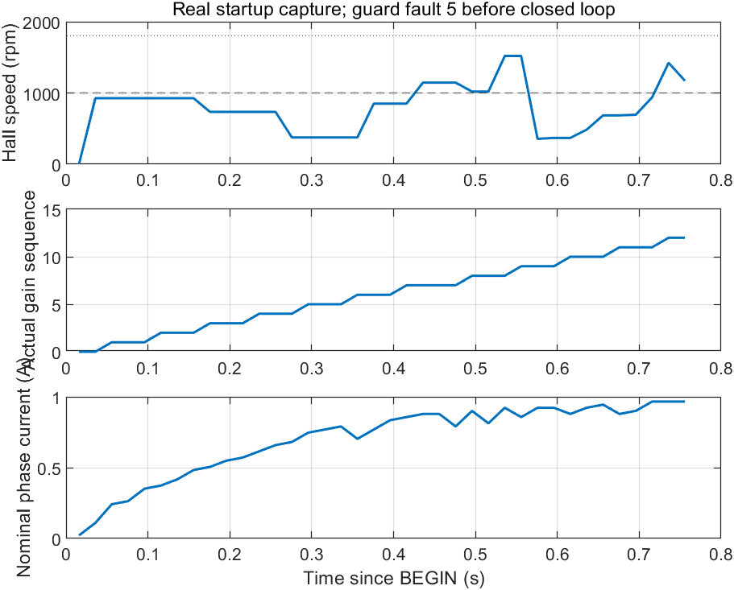

# 2026-10-11：第一次 CAN 实机 PI 参数应用与保护停机

这是 2026-10-11 的历史记录。v4 已于 2026-10-12 烧录并完成闭环短试验，见[后续实测](speedloop-v4-closed-loop-trial-20261012.md)；下文的“尚未烧录”描述保留当日状态。

## 实际完成的工作

板上使用已烧录的 `g431-speedloop-pi-motion-v3`，Flash SHA-256 为
`7128a27aad687c31a3bc26c2734eb6ea3d79cc96922addf0b2f6319d25fd3c93`。
没有重新烧录，没有运行 Actor。Codex 管理的本地主机程序发送 BEGIN，再按约
60 ms 周期发送成对 Kp、Ki；MCU 在实际 1 ms PI 边界提交，返回实际增益、应用序号和时间。

初始参数来自 `17.SpeedLoop`：Kp = 0.003389、Ki = 0.00144。计划在启动后
2.4～2.7 s 小幅增加 Kp 4%，然后返回初值；目标为 1000 rpm，主机计划在
2.85 s STOP，固件上限仍为 3 s。实际试验在约 0.8 s 提前触发保护，**没有执行这个 4% 探测**。

| 项目 | 实测结果 |
|---|---:|
| 完整遥测 | 40 组，其中 38 组输出使能 |
| 板端采样间隔中位数 | 19.998 ms |
| 发出的 GAINS 命令 | 13 次 |
| 确认实际应用的 GAINS | 12 次，序号 1～12 |
| 从源状态时间到实际应用 | 29.997～48.999 ms |
| 实际应用的不同增益对 | 1 对；尚未覆盖不同参数 |
| 最后完整运动快照时间 | BEGIN 后 755.858 ms |
| 完整快照中的名义峰值相电流 | 0.966797 A |
| 完整快照中的最高 Hall 转速 | 1519.468 rpm |
| 停机后 MCU RAM 中的 Hall 转速 | 5972.378 rpm |
| 固件锁存保护码 | 5：超速 |
| 停机后模型状态 | 3：OpenStage |
| 速度闭环阶段快照 / TD3 训练经验 | 0 / 0 |

第 13 条 GAINS 没有确认实际应用，不能算成功动作。触发故障的遥测在第一版主机检查中
被拒绝，但没有写入原始文件；5972.378 rpm 和故障码来自随后暂停状态的真实 RAM 回读，
不能冒充这 40 组遥测中的某一帧。已修正主机入口，后续会保存首个拒绝帧。

## 为什么这次不能训练 TD3

原模型先经过 0.2 s 对齐和 2 s 开环启动，之后才进入 RunStage。
本次停机时仍在 OpenStage；早期 Kp、Ki 虽然实际写入，电机的启动驱动仍由原模型的启动逻辑决定。
因此这些响应不能作为速度闭环的增益效果数据，也不能拿启动误差与之前稳态基线比较。

Codex 用 MATLAB R2024b 读取原始日志，逐条核对应用值、序号和时间，并输出曲线及
机器可读分析。没有向经验池加入数据，没有梯度更新，没有把初始化网络标成训练好的 Actor。

## 已定位的现象与尚未确认的原因

MCU 回读：Hall 周期计数 2679，按例程公式 `16000000 / period` 对应 5972.378 rpm；
CAN 发送故障和板级 IRQ 故障均为 0，协议保护码为超速 5。
这说明本次停止由 Hall 转速边界触发，而非 CAN 失联。

原 Hall 实现使用单个 XOR 边沿周期，没有记录方向或完整扇区变化序列；16 位 TIM4
计数器还会在约 20.48 ms 回绕。对齐/开环期间的反向越界、抖动、计时回绕或实际快速转动
都需要进一步区分。现有记录不足以断言哪一个是根因，也不足以证明机械轴真的达到 5972 rpm。
下一次应先记录原始 Hall 边沿、扇区变化方向和模型阶段，再修正观测与启动接入；不能屏蔽异常或提高 1800 rpm 上限来继续训练。

## v4 已实现的修正（尚未写入板子）

`g431-speedloop-pi-motion-v4` 改用连续 Hall 边沿的 64 位微秒时间差，避免直接把
16 位捕获计数当成完整周期。首个边沿不估算速度；后续只接受原例程
`5→4→6→2→3→1→5` 扇区顺序的相邻正向或反向变化，计算带方向的速度和角度增量。
同一状态、跳过扇区、无效代码和时间倒退仍触发停止；速度没有裁剪或低通隐藏，1800 rpm
绝对值上限不变。还加入冻结的 32 条原始边沿记录，保存完整时间差、原捕获值、Hall 前后状态、模型阶段和估算速度。

50 个目标翻译单元编译通过；10 项 Hall 专项检查验证多次 16 位计数回绕、方向、32 位以上时间戳和
不裁剪高速输入；10 项运动适配器及 3 项专用编解码检查通过。新镜像 SHA-256 为
`902b5dd09f9873a1143798852e55414102e131fa0ab16ad983e145cde0e45ef2`。
这些是软件验证，尚未证明该板启动问题已经解决。

下载前电脑未检测到指定 STLink，工具在任何复位或 Flash 擦写之前等待连接，已停止等待。
专用入口已改为探头不存在时立即报错。当前板上最后核验的仍是 v3；恢复 USB/STLink 后再执行
完整镜像核对、更新、读回和禁止运动启动检查，之后才安排故障后的人工确认试转。

## 供电、停止与试验例外

首个尝试时用户已拔掉 24V，MCU 名义母线仅约 1.655 V，HELLO 首帧发送超时；没有 BEGIN/GAINS。
用户确认重新接通后，第二次试验启动前母线为 24.320 V。新增主机检查：母线不在 18～30 V
时不发送任何 CAN 或运动请求。

第二次结束发送 STOP，并通过调试口先清除 MOE、三相通道，将六路功率引脚设为 GPIO 低电平，
再暂停核心，最后释放 CAN。最终 MOE 关闭、三相通道关闭、六路 GPIO 低电平。
保持 24V 的准备仍只适用于完整镜像一致、已经核验输出关闭的这份专用固件。

这次沿用用户批准的短时无温度门例外，温度保持未知，`SKILL.md` 和普通训练门没有修改。
名义电流转换尚未独立标定；本运动版本还没有集成独立 CPU 停滞 IWDG。这些限制仍需记录，
不能把这次参数应用记录当作完整运动保护验收或 TD3 部署结果。

## 交付记录

- [MCU 实机试验摘要](../examples/controller-comparison-20261011/speedloop-real-gain-trial.json)
- [原始完整遥测](../examples/controller-comparison-20261011/speedloop-real-gain-telemetry.jsonl)
- [原始下发命令](../examples/controller-comparison-20261011/speedloop-real-gain-commands.jsonl)
- [停机后的 MCU RAM 读数](../examples/controller-comparison-20261011/speedloop-real-gain-fault-readback.json)
- [MATLAB 审计](../examples/controller-comparison-20261011/speedloop-real-gain-analysis.json)
- [v4 编译记录](../examples/controller-comparison-20261011/speedloop-pi-motion-v4-build.json)
- [v4 运动适配器软件检查](../examples/controller-comparison-20261011/speedloop-pi-motion-v4-adapter-checks.json)
- [完整 Hall 周期与方向软件检查](../examples/controller-comparison-20261011/speedloop-pi-motion-v4-hall-checks.json)
- [CSV](../examples/controller-comparison-20261011/speedloop-real-gain-telemetry.csv)

