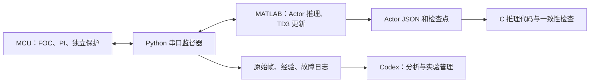

# MATLAB TD3 运行与 MCU 接入

## 实际实现的链路

本文件描述通用 TCP/mock 运行器。已经完成特定 SpeedLoop 接入后的持续真实采集、独立训练进程、测时 TD3 和候选筛选，读 [evidence-driven-tuning.md](evidence-driven-tuning.md)；历史“尚未接入”说明只适用于本文件原来的通用/诊断入口。



主机里的 Codex 管理持续运行的 Python 程序。聊天消息不参与毫秒级控制。
MATLAB 每个窗口从桥接器得到完整状态，运行 Actor，回传归一化动作；桥接器检查并发送 Kp、Ki，收到实际应用反馈后收集响应。训练与试验交替：一轮结束必须确认电机禁能，之后才调用 `trainFromData` 做 TD3 梯度更新。

`run_mock.py` 使用真实 MATLAB Reinforcement Learning Toolbox，不是用随机数假装训练。Mock 是被控对象和通信设备的替身；它不能验证实际电机动力学。已在 MATLAB R2024b、Python 3.12、GCC 上跑通。

## 可复现入口

推荐 MATLAB R2024b（已验证）、Reinforcement Learning Toolbox、Deep Learning Toolbox，以及 `tcpclient` 所需产品。当前验证环境使用 Instrument Control Toolbox。其他 MATLAB 版本先核对本地 API；`trainFromData` 自 R2023a 起提供。Python 的 mock 和审计只用标准库；串口模式另外安装 `scripts/requirements-serial.txt`。C 主机一致性测试使用 GCC，MCU 推理本身不需要 MATLAB 运行库。

所有命令从仓库根目录运行。`OUTPUT` 替换为项目规定的独立临时目录；正式模型保留到用户指定位置。输出目录必须为空，避免覆盖之前的试验。

```text
python -B skills/motor-td3-serial-tuning/scripts/run_mock.py --output OUTPUT --rounds 6
```

不在 PATH 上时增加 `--matlab MATLAB_EXECUTABLE --compiler GCC_EXECUTABLE`。

输出包括：

| 文件 | 用途 |
|---|---|
| `bridge/transitions.jsonl` | 有应用确认和设备时间的因果经验 |
| `bridge/events.jsonl` | 停机、异常、排除区间与确认状态 |
| `bridge/profile.json` | 本次实际配置 |
| `matlab/trained-agent.mat` | 完整 TD3，含 Actor、两个 Critic、经验池 |
| `matlab/training-summary.json` | 样本数量、奖励、Actor 权重变化 |
| `matlab/evaluation-summary.json` | 独立工况固定 PI 与无探索 TD3 比较 |
| `matlab/actor/actor.json` | 仅 Actor 权重、尺度、增益映射与版本 |
| `matlab/actor/matlab-reference.json` | MATLAB 推理参考输入/输出 |
| `actor-c/motor_actor.c/.h` | 无动态内存的 C99 推理代码 |
| `actor-c/deployment-manifest.json` | 源文件哈希、版本、未获实机部署验证的状态 |
| `actor-c/c-parity-summary.json` | 主机 C 与 MATLAB 的数值一致性 |
| `run-summary.json` | 适合 Codex 阅读的汇总结果 |

令牌文件只用于本机 RPC 认证，不上传 GitHub。桥接器监听 `127.0.0.1`，一次接受一个客户端；仅有网络连接/心跳不能续期运动，新的有效动作才续动作租约。工具失联、动作超时和未知响应会锁存本次会话，禁止自动重启。

## 状态、动作与奖励

固定字段顺序：`speed_ref, speed, speed_error, error_history, integral_output, current, vbus, kp, ki, elapsed_ms`。
速度单位 rpm，积分输出与电流单位 A，母线 V，回合时间 ms。`error_history` 是上一个速度控制周期的误差；`current` 必须定义为设备验证过的反馈量，例如 q 轴实测电流。没有测量值不能填零冒充。

输入按 `runtime.state_scale` 除以固定物理尺度，随后限制到 `[-5,5]`。检查非有限数在这一步之前执行。
Actor 为 `10 → 16 ReLU → 16 ReLU → 2 tanh`，输出 `a_kp,a_ki`。

每个增益的当前值为 `g`，本次允许区间为 `lo=max(g_min,g-step)`、`hi=min(g_max,g+step)`：

\[
g' = \begin{cases}g+(hi-g)a,&a\ge0\\g+(g-lo)a,&a<0\end{cases}
\]

零动作保持当前参数。映射是环境定义的一部分，Critic 回放记录的动作仍为 `a`。主机转 float32 后发送；舍入若跨出本次允许区间，取相邻的区间内 float32 值。C 网络用单精度，局部增益映射用双精度边界计算后转 float32，以保持相同的工程步长契约。固件用至少 9 位有效数字回报 float32 值。应用值不一致、序号变化、时序错误或安全干预的响应不进入普通 TD3 回放。

窗口奖励为负的归一化速度误差均方值，再减去 `0.05×电流占用均方值` 与 `0.001×动作平方和`。示例权重只用于实现和 mock 演示，应按实际目标验证。硬件保护独立执行，不能靠奖励防过流。

普通时间/动作预算结束标为 `truncated`，MATLAB `IsDone=0` 保留 bootstrap。当前实现对于未知终点、通信错误、过流等故障整段排除并锁存；没有伪造终止经验。梯度更新数量有限，保存每轮候选和归一化版本。

## 实机桥接器

从 `assets/session-profile.example.json` 建立新配置，补齐来源证据、工程边界、协议验证、停机验证和运行计划。`mock-profile.json` 的所有数值和验证标记都是模拟设备专用，运行时禁止它用于真实串口。

```text
python -B skills/motor-td3-serial-tuning/scripts/session_checks.py check-profile LIVE_PROFILE --live
python -B skills/motor-td3-serial-tuning/scripts/motor_runtime.py --profile LIVE_PROFILE --output OUTPUT --token-file TOKEN_FILE --transport serial --allow-live
```

`--allow-live` 是操作者选择真实运动入口，不替代会话中用户的授权或设备验证。端口被监督器独占；VOFA/MATLAB 串口对象先断开。打开串口的 DTR/RTS 对目标板的影响也需验证。

在 MATLAB 中：

```matlab
addpath('skills/motor-td3-serial-tuning/matlab');
trainMotorTD3(47653,'TOKEN_FILE','MODEL_OUTPUT',6);
```

实机第一版用已验证基准周围的小幅探索收集经验，每轮停机后训练候选；训练出来的新网络不会自动接管实机。网络从零开始训练的数据量通常远多于演示的 180 条，应优先改用可信仿真预训练，再规划有界实机微调。

经典 CAN 也可使用同一个 MATLAB 接口：在板端已接入 `motor-td3-can-v1` 并完成独立保护验证后，使用 CAN 配置与 `--transport can --allow-live` 启动桥接器，详见 [can-runtime.md](can-runtime.md)。原厂占位帧和独立诊断回包没有训练语义；本次 CAN 应用层验证来自软件 C 端点，尚未在实际 FOC 固件中运行。

这是实时闭环的边界：MCU 仍运行自己的 1 ms 控制任务，桥接器的读线程持续接收状态；MATLAB 只在已限定的响应窗口选择下一次动作。每轮确认停机后，MATLAB 调用桥接器的 `metadata` 操作；桥接器刷新 `transitions.jsonl`，返回运行 ID、固件/协议身份、实时闭环标记、样本数和该文件的 SHA-256，训练摘要和导出的 Actor 会保存这个哈希。Codex 在部署前重新计算文件哈希并与 `training_data.dataset_sha256` 比较，哈希缺失或不一致时拒绝部署。

要评估已训练的实机候选，启动新的桥接器并增加 `--approved-policy candidate-NNN`，随后调用 `evaluateCheckpoint(PORT,TOKEN_FILE,CHECKPOINT,REPORT_FILE)`。版本身份、尺度和增益映射必须完全一致；模拟训练的模型被此实机入口拒绝。固定 PI 和候选使用相同给定与计划。实机负载、初始转速、积分状态和冷却条件必须由操作者/固件建立；mock 的 seed 不会创造实际负载或替代可重复初态。不要据此报告不存在的负载对比。

## 上传与部署

上传仓库只上传代码、配置模板及注明模拟范围的验证摘要。原始串口日志、令牌、检查点、私有工程与设备身份留在本地。

从训练结果生成 MCU C 文件：

```text
python -B skills/motor-td3-serial-tuning/scripts/actor_codegen.py --model ACTOR_JSON --output C_OUTPUT --reference MATLAB_REFERENCE_JSON --compiler GCC_EXECUTABLE
```

小网络有 482 个可训练参数，权重 float32 共 1,928 字节；中间向量 168 字节。实际 Flash、栈和执行时间还包括编译器、`tanhf` 和调用链，需要在目标 MCU 测量。代码导出只支持此固定网络结构，其他层/结构会拒绝。

把 `motor_actor.c/.h` 和 `firmware/motor_td3_guard.c/.h` 纳入目标工程，在已验证的慢速决策周期运行 Actor；只有 guard 接受动作才能改速度 PI。既有电流环、速度环和 PWM 仍在 MCU 正常调度。详见 [firmware-integration.md](firmware-integration.md)。

主机 C 一致性通过之后，继续目标编译、SIL/PIL、实际时间/内存测量和受限电机测试。最终烧录应使用该工程已有下载流程和用户已授权的硬件会话。仓库未接入任何具体板卡的烧录器，不会从一次 mock 训练自动烧写固件。

## 依据

- [MathWorks TD3 Agent](https://www.mathworks.com/help/reinforcement-learning/ref/rl.agent.rltd3agent.html)
- [MathWorks trainFromData](https://www.mathworks.com/help/reinforcement-learning/ref/trainfromdata.html)（实际调用已用 R2024b 本地帮助和执行验证）
- [已部署策略的学习与通信时间](https://www.mathworks.com/help/reinforcement-learning/ug/fine-tune-deployed-policy.html)
- [从已训练策略生成代码](https://www.mathworks.com/help/reinforcement-learning/ug/generate-code-from-trained-policies.html)
